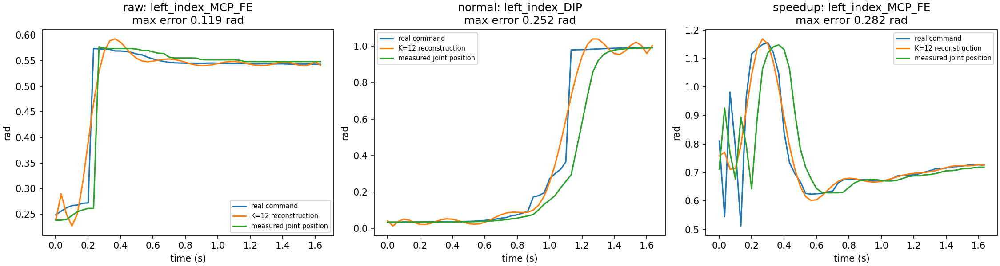
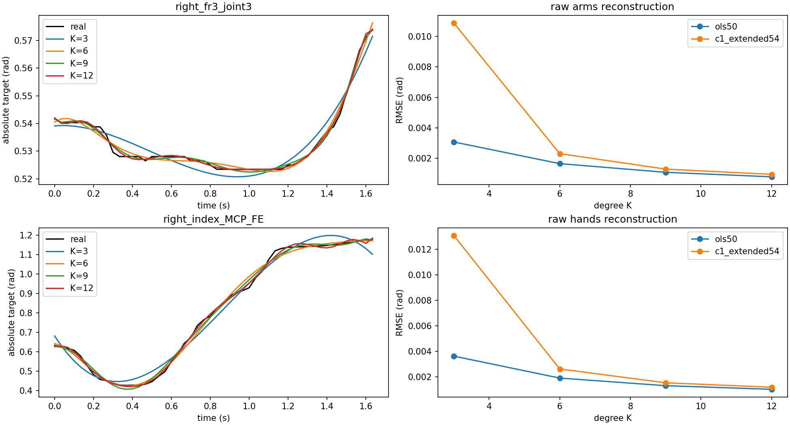
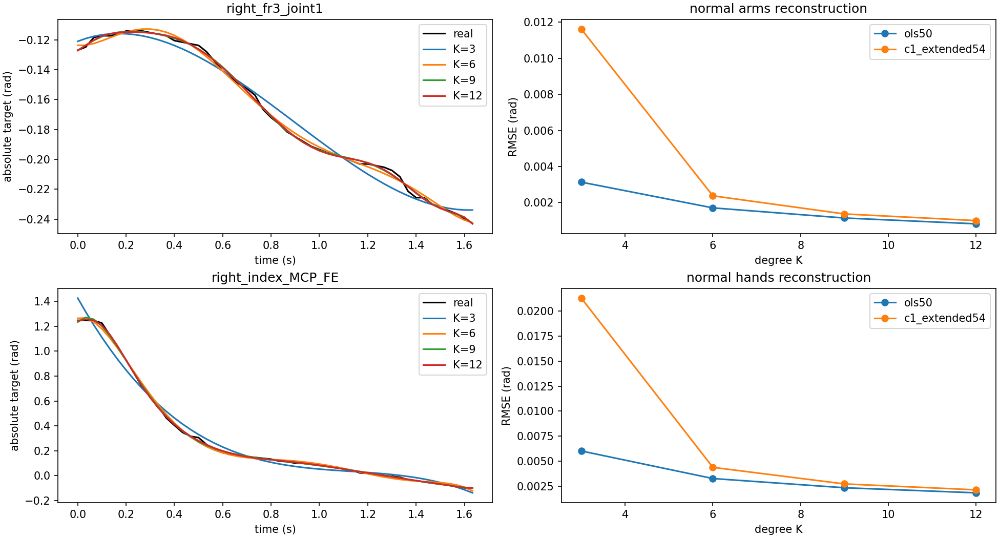
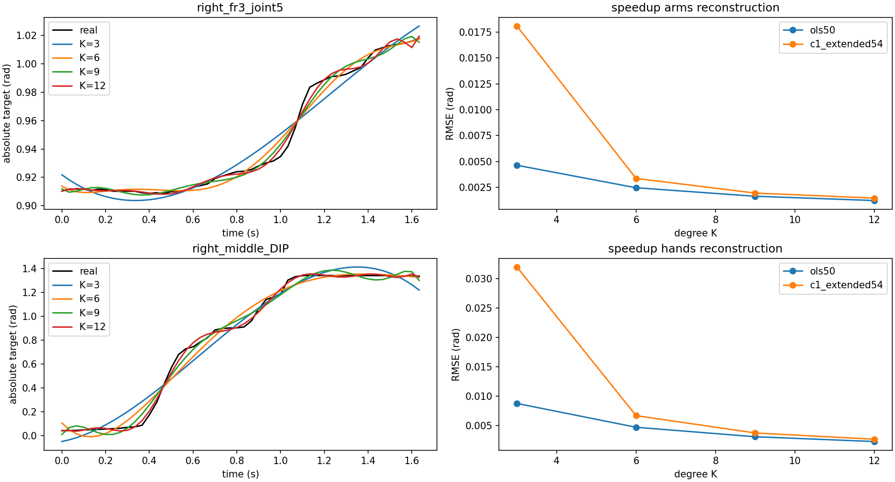

# 真实 LeRobot Polynomial Reconstruction（P0）

状态：数值和语义测试通过；表示质量尚未判定通过。平均重建误差较小，但手部急变、局部极值和相邻 Chunk 边界问题仍明显；未启动 Expert 开发/训练。用户尚未给出任务误差容限，本轮不虚构通过阈值。

## 数据与方法

从 202 的原始发布数据、28 的 normal/speedup 发布数据只读抽取，共 **23 个 dataset roots、69 个 Episode、2,195 个不跨 Episode 的完整窗口**。每 root 按排序取首、中、末 Episode，并非全量覆盖，也不是独立随机样本。raw/normal 可能包含同源或相同轨迹；分类型报告，不能把 69 条视为互不重叠演示或将它们随机拆成训练/验证。

所有选中数据 metadata fps=30，action=58D absolute joint targets，state=116D。动作按 main canonical joint names 重排，再分双臂14D/双手44D。所有抽取样本检查 finite、单一 episode、frame 连续、timestamp 与 30Hz 一致，未发现失败。根据明确的 main converter 契约与字段名 `.position/.command` 解释绝对关节目标；没有 Delta cumsum。原始完整模态依然保留在服务器，本轮仅抽取所需数值列，未读取触觉/视频 payload。

取窗口起点 2,52,102,…，保留两侧真实上下文，不对尾部重复 padding。每窗口输出未来 tick 0..49，首末采样间隔 49/30秒；Chunk 调度间隔 50/30秒。均在物理 rad 上评估，无归一化、裁剪或数据清洗，因此这是表示误差而非训练结果。

- K=3/6/9/12 表示最高次数，即4/7/10/13个系数。
- `ols50`：仅用未来50步，float64 SVD least squares。
- `c1_extended54`：真实上下文[-2,51]，overlap[-1,50]、outer pad各1；在0与50两端锚定真实位置及中心差分速度，用加权KKT修正。
- 先 stride=1；stride=2/4 仍固定相同物理范围，用稀疏节点拟合并包含两端，重建回原50步。与论文扩大时间范围的 sparse training 不同。
- 对各类型全部窗口/时间/所属关节加权计算MAE/RMSE。极值不做分位数裁剪；per-joint最大误差另存CSV。

## stride=1 普通拟合

单位均为rad；max为该组全部关节/窗口的绝对误差最大值。

| 类型 | K | 窗口 | 双臂 MAE | 双臂 RMSE | 双臂 max | 双手 MAE | 双手 RMSE | 双手 max |
|---|---:|---:|---:|---:|---:|---:|---:|---:|
| raw | 3 | 284 | 0.001101 | 0.003079 | 0.063588 | 0.000904 | 0.003626 | 0.180126 |
| raw | 6 | 284 | 0.000605 | 0.001657 | 0.044498 | 0.000470 | 0.001905 | 0.134173 |
| raw | 9 | 284 | 0.000415 | 0.001088 | 0.032424 | 0.000322 | 0.001309 | 0.132166 |
| raw | 12 | 284 | 0.000310 | 0.000792 | 0.021579 | 0.000250 | 0.001024 | 0.118835 |
| normal | 3 | 1119 | 0.001166 | 0.003135 | 0.077910 | 0.001405 | 0.006013 | 0.460615 |
| normal | 6 | 1119 | 0.000644 | 0.001707 | 0.044498 | 0.000740 | 0.003255 | 0.332349 |
| normal | 9 | 1119 | 0.000444 | 0.001146 | 0.032424 | 0.000510 | 0.002332 | 0.267955 |
| normal | 12 | 1119 | 0.000329 | 0.000823 | 0.021579 | 0.000393 | 0.001826 | 0.252330 |
| speedup | 3 | 792 | 0.001698 | 0.004622 | 0.117603 | 0.002106 | 0.008775 | 0.445687 |
| speedup | 6 | 792 | 0.000908 | 0.002449 | 0.075465 | 0.001094 | 0.004732 | 0.446750 |
| speedup | 9 | 792 | 0.000609 | 0.001625 | 0.041919 | 0.000709 | 0.003121 | 0.361341 |
| speedup | 12 | 792 | 0.000449 | 0.001213 | 0.034298 | 0.000511 | 0.002310 | 0.282338 |

## 相邻 Chunk 连续性与 C1 的代价

相邻两个多项式必须在**同一物理时刻**比较：前一块 tick=50 与后一块 tick=0，不能直接把前一块第49步与后一块第0步的正常运动差当成数学不连续。`ols50`在共享边界多评估1个tick，因而可揭示边界外推敏感性。速度是解析导数rad/s；重建速度误差参考原目标中心差分。以下为K=6、stride=1。

| 类型 | 模式 | 双手重建 RMSE(rad) | 双手位置 gap RMSE(rad) | 双手速度 gap RMSE(rad/s) | 双手速度误差 RMSE(rad/s) |
|---|---|---:|---:|---:|---:|
| raw | ols50 | 0.001905 | 6.212e-03 | 1.367e-01 | 0.035851 |
| raw | c1_extended54 | 0.002619 | 9.699e-17 | 2.708e-17 | 0.033774 |
| normal | ols50 | 0.003255 | 9.667e-03 | 2.510e-01 | 0.062882 |
| normal | c1_extended54 | 0.004373 | 1.028e-16 | 3.673e-17 | 0.059162 |
| speedup | ols50 | 0.004732 | 1.496e-02 | 4.046e-01 | 0.088931 |
| speedup | c1_extended54 | 0.006704 | 1.014e-16 | 5.761e-17 | 0.082183 |

C1目标在相同真实锚点处达到浮点精度连续；这只是目标构造正确性的验证，不是可用未来真值的部署方案。加约束可能增加局部拟合误差；例如normal、K=6的手部最大误差从0.332rad增加到0.545rad。增加degree也可能放大端点导数，不能仅凭位置平均误差选K。

## 稀疏节点固定范围诊断

K=12的13个系数在stride=4时仅有约14–15个节点；接近插值的高阶多项式明显振荡。OLS几何条件数与每组所有指标均保存在JSON。以下为手部误差：

| 类型 | stride | 模式 | 手部 RMSE(rad) | 手部 max(rad) | condition(S) |
|---|---:|---|---:|---:|---:|
| raw | 1 | ols50 | 0.001024 | 0.118835 | 4.93 |
| raw | 1 | c1_extended54 | 0.001185 | 0.128878 | 4.91 |
| raw | 2 | ols50 | 0.001093 | 0.141066 | 5.68 |
| raw | 2 | c1_extended54 | 0.001232 | 0.157870 | 5.44 |
| raw | 4 | ols50 | 0.005574 | 0.925822 | 41.57 |
| raw | 4 | c1_extended54 | 0.001392 | 0.215694 | 24.48 |
| normal | 1 | ols50 | 0.001826 | 0.252330 | 4.93 |
| normal | 1 | c1_extended54 | 0.002122 | 0.266996 | 4.91 |
| normal | 2 | ols50 | 0.001932 | 0.319324 | 5.68 |
| normal | 2 | c1_extended54 | 0.002191 | 0.275860 | 5.44 |
| normal | 4 | ols50 | 0.009477 | 2.127280 | 41.57 |
| normal | 4 | c1_extended54 | 0.002406 | 0.379036 | 24.48 |
| speedup | 1 | ols50 | 0.002310 | 0.282338 | 4.93 |
| speedup | 1 | c1_extended54 | 0.002706 | 0.426988 | 4.91 |
| speedup | 2 | ols50 | 0.002441 | 0.636741 | 5.68 |
| speedup | 2 | c1_extended54 | 0.002768 | 0.441322 | 5.44 |
| speedup | 4 | ols50 | 0.012652 | 2.426439 | 41.57 |
| speedup | 4 | c1_extended54 | 0.003040 | 0.390967 | 24.48 |

## 急变窗口定位

以下均为K=12、stride=1、ols50在所属类型的最大手部误差窗口。保留异常原样；不能擅自平滑或删去真实指令。测得command与measured位置有响应延迟，不能直接把监督目标换成实测状态来宣称拟合变好。

- **raw**：`left_index_MCP_FE`，frame=308，window_start=302；max error=0.118835rad，窗口中真实目标单步最大变化=0.301937rad。来源 `/data/data-fruits/real/harvest-tomato/data/data-lerobot/sharpa/B/130_423_data_lerobot/data/chunk-000/episode_000017.parquet`；sample ID `3ee3c39f61f6dd5e`。
- **normal**：`left_index_DIP`，frame=386，window_start=352；max error=0.252330rad，窗口中真实目标单步最大变化=0.614662rad。来源 `/mnt/data/train_platform/datasets/tomato_sharpa/normal/no-block-more/A/1102_588_616_normal_lerobot/data/chunk-000/episode_000002.parquet`；sample ID `606140b9fb30c1e5`。
- **speedup**：`left_index_MCP_FE`，frame=4006，window_start=4002；max error=0.282338rad，窗口中真实目标单步最大变化=0.452185rad。来源 `/mnt/data/train_platform/datasets/tomato_sharpa/speedup/no-block-more/A/1102_588_616_speedup_lerobot/data/chunk-000/episode_000001.parquet`；sample ID `09ff3e7075088752`。

## 图表与完整结果

每类轨迹示例为该类首个抽取Episode中手部运动幅度最大的窗口，未挑选最容易拟合的静止窗口；最坏误差图另行定位全部样本。degree对比为该类型全部窗口的误差。

- `results/reconstruction.json`：72组完整数值、per-joint max、每Episode指标、局部最坏窗口、所有源路径/抽样行数/FPS和指纹。
- `results/per_joint_max.csv`：72×58个关节极值，区分类型、K、stride、mode。
- `sha256`指纹对应本地抽取列的Parquet文件，不是含触觉/视频payload的整个源文件；源路径与源文件字节数另行记录。
- `.cache/flash_samples/manifest.json`：本地样本完整metadata及指纹，真实Parquet样本仅在该Git忽略目录，不提交。

## P0判断

Legendre可有效压缩大部分双臂与平缓手部轨迹，但当前单段全关节多项式对急变手部目标存在明显表示偏差，稀疏高阶配置还会失稳。建议先比较更短分段或polynomial+residual等候选，固定原始监督和物理误差指标，确定任务容限后再决定进入E1/E2。没有证明FLASH不适用，也没有证明其官方性能能迁移到当前任务。P0不等于完整FLASH，History-Anchored Flow尚未实现。
