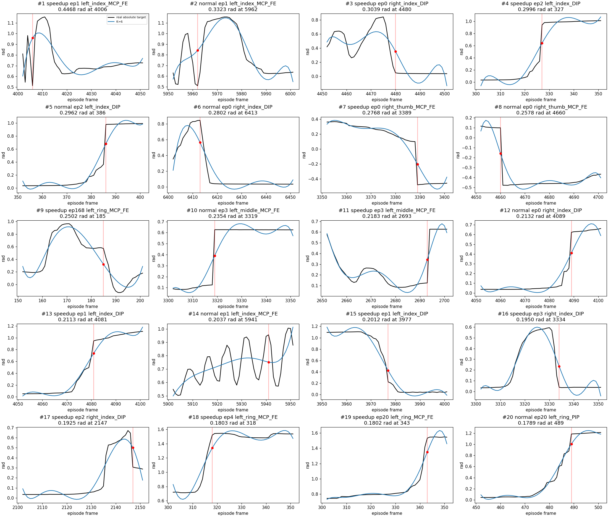
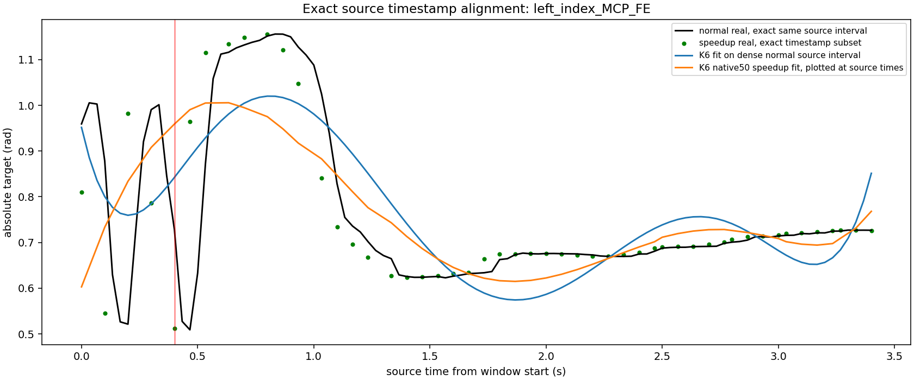

# P0.5 真实动作局部误差诊断

结论：K=6 对多数动作标量拟合良好，但存在不能被平均 RMSE 代表的手指急变失败。当前结果支持开展标准 FLASH 的离线最小实现与小规模验证，尚不能证明该表示满足机器人操作精度要求。没有修改动作标签、清洗失败样本或启动训练。

## 数据、索引与误差口径

沿用 P0 的全部 **69 个真实 Episode、2,195 个完整窗口**，manifest SHA256 为 `9ecac99f13f35f7717164d73575fd2c4545a21dcbcf39efb5dd3f42f694de4e9`。样本来自 raw / normal / speedup，动作是 main canonical 顺序的绝对关节目标，维度 `(50,58)`，30 Hz，双臂 14D、双手 44D。窗口 start=2,52,102,…；不跨 Episode，不做 Delta 累加，不补尾帧。K 是最高多项式次数，因此 K=6 有 7 个系数。

P95/P99 是所有窗口×时间×组内关节的**绝对标量误差**分位数，单位 rad；另报告窗口内最大绝对误差的分位数，保留每关节指标和最坏窗口，避免大量静止手指稀释异常。`>0.1 rad` 仅为描述性计数，不是用户批准的通过阈值。同源 raw/normal 不能被视为独立实验。

已通过只读 SSH 获取选中 Episode 的真实 `meta/episodes.jsonl`，[source_metadata.json](results/p05/source_metadata.json) 保留原始 source_recording_id、source_start_ns、source_end_ns 和发布 episode_index。原始 ID 不是从发布 Episode 编号猜测。

## K=3/6/9/12 全部统计

|版本|K|分组|MAE|RMSE|P95|P99|Max|
|---|---:|---|---:|---:|---:|---:|---:|
|raw|3|arms|0.00110067|0.00307902|0.00542470|0.01381176|0.06358825|
|raw|3|hands|0.00090445|0.00362556|0.00416650|0.01447795|0.18012589|
|normal|3|arms|0.00116587|0.00313519|0.00592590|0.01424547|0.07790981|
|normal|3|hands|0.00140526|0.00601304|0.00618664|0.02212965|0.46061542|
|speedup|3|arms|0.00169770|0.00462248|0.00858131|0.02079994|0.11760328|
|speedup|3|hands|0.00210629|0.00877492|0.00966004|0.03428489|0.44568722|
|all|3|arms|0.00134933|0.00373461|0.00681910|0.01676961|0.11760328|
|all|3|hands|0.00159341|0.00692214|0.00708566|0.02570044|0.46061542|
|raw|6|arms|0.00060550|0.00165729|0.00296143|0.00758647|0.04449832|
|raw|6|hands|0.00046970|0.00190486|0.00202137|0.00700303|0.13417306|
|normal|6|arms|0.00064386|0.00170730|0.00321737|0.00783228|0.04449832|
|normal|6|hands|0.00074018|0.00325538|0.00307992|0.01095495|0.33234938|
|speedup|6|arms|0.00090844|0.00244863|0.00459189|0.01099076|0.07546535|
|speedup|6|hands|0.00109392|0.00473157|0.00472711|0.01759256|0.44675040|
|all|6|arms|0.00073436|0.00200119|0.00368771|0.00904793|0.07546535|
|all|6|hands|0.00083282|0.00373496|0.00347991|0.01290670|0.44675040|
|raw|9|arms|0.00041505|0.00108795|0.00204680|0.00489703|0.03242411|
|raw|9|hands|0.00032207|0.00130852|0.00133390|0.00450298|0.13216607|
|normal|9|arms|0.00044402|0.00114600|0.00221181|0.00521925|0.03242411|
|normal|9|hands|0.00051041|0.00233169|0.00202689|0.00718705|0.26795450|
|speedup|9|arms|0.00060886|0.00162545|0.00301328|0.00723414|0.04191875|
|speedup|9|hands|0.00070861|0.00312104|0.00296070|0.01092887|0.36134149|
|all|9|arms|0.00049975|0.00133266|0.00247857|0.00595085|0.04191875|
|all|9|hands|0.00055756|0.00255105|0.00223799|0.00822641|0.36134149|
|raw|12|arms|0.00031040|0.00079236|0.00152222|0.00353032|0.02157949|
|raw|12|hands|0.00025008|0.00102405|0.00102179|0.00336368|0.11883524|
|normal|12|arms|0.00032850|0.00082343|0.00163255|0.00371183|0.02157949|
|normal|12|hands|0.00039261|0.00182564|0.00153485|0.00534552|0.25232975|
|speedup|12|arms|0.00044901|0.00121331|0.00220361|0.00539603|0.03429814|
|speedup|12|hands|0.00051119|0.00230989|0.00207972|0.00766259|0.28233756|
|all|12|arms|0.00036964|0.00097881|0.00181734|0.00429904|0.03429814|
|all|12|hands|0.00041696|0.00193907|0.00164694|0.00593726|0.28233756|

K=6 的窗口局部极值进一步说明长尾：

|版本|窗口数|窗口峰值P95|窗口峰值P99|峰值>0.1rad窗口数|
|---|---:|---:|---:|---:|
|raw|284|0.044902|0.074592|1|
|normal|1119|0.077422|0.168913|34|
|speedup|792|0.115232|0.195531|52|
|all|2195|0.088385|0.176638|87|

[每关节 MAE/RMSE/P95/P99/Max](results/p05/per_joint.csv) 包含 4 个 K × 4 个版本口径 × 58 关节。整体表不能替代该关节级检查。

## 最坏窗口与原因

[top20_windows.csv](results/p05/top20_windows.csv) 对每个 K 分别输出双臂/双手最坏 20 个窗口，共 160 条，包含真实原始 ID、发布 Episode、版本、源路径、帧区间、峰值帧、关节名称、单步幅度与距离窗口边缘。每个窗口按组内最大误差排名。

K=6 手部最坏案例：

- speedup，sample `09ff3e7075088752`，发布 ep1，原始 ID `e4bdeafd7d834062bfba2ad01049a5b8`；frames **4002–4051**，`left_index_MCP_FE` 在 frame **4006** 误差 **0.446750402 rad**，单步目标变化 **0.452184737 rad**。曲线存在数帧内下探与反弹，六阶全局平滑多项式无法恢复该窄瞬态。

- 同源 normal，sample `d8f720863e569786`，ep1，frames **5952–6001**；同关节 frame5962 误差 **0.332349378 rad**，单步目标变化 **0.238054335 rad**。说明原 normal 已存在急变，speedup 对它作时间压缩后加重表示难度，不能把全部失败归咎于时间重采样。

- normal ep2 的 `left_index_DIP` 在 frame386 为阶跃式目标；单步变化 **0.614662319 rad**。K=6 峰值约 **0.2962 rad**，P0 中 K=12 仍有 **0.2523 rad**。提高阶数降低整体误差仍无法忠实重现不连续目标。

K=6 手部最坏 20 个窗口没有任何峰值位于距两端 <3 tick 的位置。最坏峰值 tick4、其次 tick10，另有 tick28 等内部急变；因此窗口端点确有放大风险，但不是此次失败的唯一来源。这里分析的是采集到的 command，不对其物理合理性作未经验证的判断，也不擅自用 measured state 替换标签。



其余所有 K 与分组曲线：
- [K=3 arms 最坏20曲线](results/p05/top20_K3_arms.png)
- [K=3 hands 最坏20曲线](results/p05/top20_K3_hands.png)
- [K=6 arms 最坏20曲线](results/p05/top20_K6_arms.png)
- [K=6 hands 最坏20曲线](results/p05/top20_K6_hands.png)
- [K=9 arms 最坏20曲线](results/p05/top20_K9_arms.png)
- [K=9 hands 最坏20曲线](results/p05/top20_K9_hands.png)
- [K=12 arms 最坏20曲线](results/p05/top20_K12_arms.png)
- [K=12 hands 最坏20曲线](results/p05/top20_K12_hands.png)

## raw / normal / speedup 对应关系

已补充读取原始远程 Parquet 的 **source_timestamp_ns**，不是根据帧数猜测映射。该列原始 schema 已声明，P0 数值缓存没有提取它；本轮通过 RemoteFile 只读取该列并缓存至 `.cache/flash_source_times/`，覆盖全部 69 个 Episode。结果中的 source_time_provenance 保留源路径和本地列文件 SHA256。时间映射使用 int64 纳秒，避免 float64 在约 1.79e18 ns 附近丢失精度。

根据真实 source_recording_id 建立 **42 个与 normal 的同源配对**；全部时间戳能精确映射为 normal 时戳的严格递增子集。**15 对 raw-normal 动作逐元素完全相等**，因此相同窗口误差相同。**27 对 speedup-normal 的时戳保留原始源时间，但动作并不完全相等**：相同 source_timestamp_ns 对齐后的 action 最大差为 **0.578045882 rad**。完整证据见 [matched_originals.csv](results/p05/matched_originals.csv)。因此“有精确源时间映射”不等于“同一时戳的动作标签未改变”。相同时戳的 measured joint position 也并非完全相等，全部 speedup 配对的 state 最大差为 **0.106278129 rad**；不能声称“状态相同、只有 command 错位”。最大 action 差对应 `right_thumb_MCP_FE`、speedup frame3389 / normal frame4660，原始 ID `282b5b5cad9f4aa8bd40e0cbac21695d`；state 最大差对应另一条原始 ID `34d3f5750f7049e0a0e73024589b7863` 的 `left_thumb_MCP_AA`、speedup frame4619。

最坏 K6 speedup 窗口 frames4002–4051 对应 normal **5948–6050**，包含 **103 个 normal 帧 / 原始时间3.4秒**，而发布的 speedup 时间轴仍为50步、49/30=1.633秒。speedup 源帧增量为1–3，说明是非均匀时间压缩，而不是原始时戳被重置。frame4006 的精确 source timestamp 对应 normal **5960**；该窗口相同时戳 action 最大差 **0.460515618 rad**，state 最大差 **0.031660795 rad**。整个该 Episode 的 state 最大差 **0.037168741 rad**、MAE **0.000157389 rad**；command 差明显大于 state，但数值证据不足以唯一确定转换原因。

[corresponding_windows.csv](results/p05/corresponding_windows.csv) 对 12 个 K6 手部最坏 speedup 窗口提供两种明确区分的比较：

- 固定 normal 原生50步并用精确源时戳锚定峰值相位：最坏案例 normal start=5956，手部最大误差约 **0.23420 rad**。原 P0 固定 start=5952 的 normal 最大误差为 **0.33235 rad**，说明窗口相位也影响误差。
- 使用完全相同的源时间区间，normal 保留所有103帧并独立做 K6 拟合：手部最大误差 **0.37764 rad**，RMSE **0.01922 rad**。此诊断窗口长度为103，不能混入本报告固定50步误差表；它展示相同原始时间区间内 normal 也有窄瞬态，speedup 又改变时间参数化和动作标签。



附加 [source_shift_diagnostics.csv](results/p05/source_shift_diagnostics.csv) 对全部27对做源帧偏移 -2/-1/0/+1/+2 以及下一选中源帧的诊断，**没有改动标签**。最坏 Episode 全58D平均绝对差：原时戳对齐约0.0010433 rad，+1源帧约0.0004144，下一选中源帧约0.0001858，但仍有0.11797 rad最大差。因此存在标签重对齐/重采样差异的证据，但仅凭数值不能确定转换程序的原因，也不能擅自按一个统一偏移修正数据。后续小规模训练必须区分版本，排查 converter 的动作取样契约；不能把该差异都算成多项式数值问题。

这次 raw 没有覆盖最新 no-block-more 记录，因此最坏新 Episode 没有 raw 配对。之前基于最近观察的推断已被精确 source_timestamp_ns 映射完全替代；所有输出表中的 alignment_status 均为 exact_int64_source_timestamp_ns。

## K12 稀疏拟合与稳定求解

所有方法在完全相同的真实窗口和稀疏节点上重建 50 ticks；没有扩大预测范围。SVD、reduced QR 都避免求解正规方程；ridge 使用 SVD 的 `sigma/(sigma²+lambda)`，本诊断对所有系数作各向同性惩罚，仅用于观察方差/偏差，不是模型默认配置。

QR 与 SVD 在全部比较中的最大预测差 **2.8866e-14 rad**。这证明原 float64 SVD 已稳定，不能仅换 QR 就消除振荡。stride=4 只剩 **14 个节点 / 13 个系数**，Legendre design condition=**41.5734**；完整50点重建矩阵的最大行 L1 范数为 **45.0412**，会放大未采样节点间的急变。接近插值、稀疏均匀节点与非光滑目标共同造成振荡，不能简单称为浮点舍入失败。

speedup 手部 K12 / stride4：

|求解|lambda|RMSE|P99|Max|
|---|---:|---:|---:|---:|
|svd|0|0.01265244|0.02149836|2.42643934|
|qr|0|0.01265244|0.02149836|2.42643934|
|ridge|0.0001|0.01253837|0.02136810|2.40374526|
|ridge|0.001|0.01162134|0.02032152|2.21726066|
|ridge|0.01|0.00788824|0.02645413|1.25322864|
|ridge|0.1|0.00886384|0.03967369|0.51298797|

lambda=0.01 能降低极端振荡，但 P99 较无正则更高；lambda=0.1 又进一步增加 MAE。不能只挑降低的 Max 宣称全面改善，更不能在本次最小标准 FLASH 中悄悄引入新算法。完整各版本/双臂/双手结果见 [sparse_solvers.csv](results/p05/sparse_solvers.csv)。

## C¹ 约束前后真实边界误差

以 K=6 对真实 action 的同一物理边界 tick50 / 下一块 tick0 比较，速度用解析导数 rad/s，真实参考为中心差分。分别直接测量真实边界误差、相邻块 gap，以及 [0,1,48,49] 近边界真实位置误差；不是只检查约束矩阵。

这里是 P0 的 **oracle 双端真值锚定上界**，右端未来真值只用于离线标签重建诊断；绝不能作为推理输入。生产可用历史锚定机制必须在 P1 另行验证。

speedup 手部：

|指标|OLS RMSE|C1 RMSE|OLS Max|C1 Max|
|---|---:|---:|---:|---:|
|boundary_position_error|0.010559842|7.1431635e-17|0.44166636|6.6613381e-16|
|boundary_velocity_error|0.28658791|3.9951274e-17|10.875925|1.7763568e-15|
|near_boundary_position_error|0.0039745425|0.0024778482|0.20764853|0.47682435|
|adjacent_position_gap|0.014957179|1.0144105e-16|0.44197496|1.110223e-15|
|adjacent_velocity_gap|0.40461043|5.7613588e-17|11.210496|2.6645353e-15|

精确锚定确实把边界真实值及相邻块 gap 降至浮点精度，但附近真实轨迹的**最大误差从 0.20765 增加到 0.47682 rad**。因此“C1成立”不等于“邻域动作准确”，更不等于预测专家已连续。P0 全窗口 C1 手部 RMSE 也从 0.004732 增加到 0.006704。完整三版本、双臂/双手数据见 [boundaries.csv](results/p05/boundaries.csv)。

## 可复现命令与验证

使用已有虚拟环境，无安装：

```bash
cd /home/user/tomato-openpi-paper-flash
OPENBLAS_NUM_THREADS=1 /home/user/sharpa-pi05/.venv/bin/python scripts/flash/diagnose_local.py --fetch-metadata --fetch-source-times
OPENBLAS_NUM_THREADS=1 /home/user/sharpa-pi05/.venv/bin/python scripts/flash/diagnose_local.py
OPENBLAS_NUM_THREADS=1 /home/user/sharpa-pi05/.venv/bin/python -m pytest -q scripts/flash/test_diagnostics.py
/home/user/sharpa-pi05/.venv/bin/ruff check scripts/flash/diagnose_local.py scripts/flash/test_diagnostics.py
```

第一条需只读 SSH 202/28，并额外抽取 source_timestamp_ns 列；第二条复用 metadata、源时间列缓存及带 SHA256 验证的本地动作 Parquet，可离线重建全部图表与结果。测试验证：绝对值分位数、QR/SVD与正则性质、int64纳秒精确源帧映射、真实样本数量/指纹、每组 MAE/RMSE 与 P0 一致、真实 source_time 配对与标签差异、实际 oracle 边界误差。测试结果：**4 passed**。Ruff：**All checks passed**。图表已查看 K6 手部全部20窗口，峰值标记与曲线对应。

[diagnosis.json](results/p05/diagnosis.json) 与 CSV 为主要可机读结果；8张最坏窗口图覆盖所有 K 和双臂/双手，另有1张精确源时间对齐图。报告保持六阶标准 Expert 路线，不引入自适应阶数、分组高阶或残差专家。等标准 P1 完成后，应再以这些失败案例比较候选改进，保留同源划分和全部局部误差指标。
