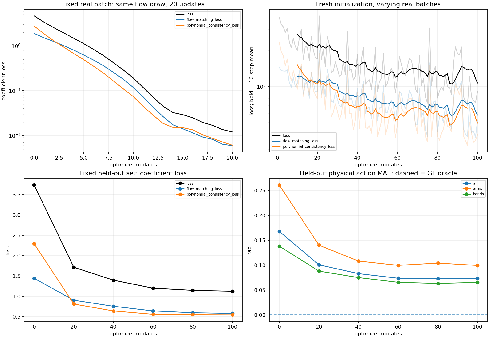
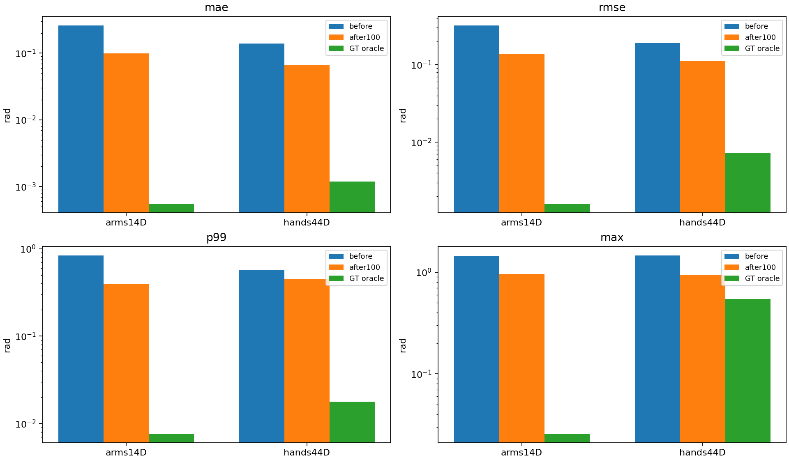
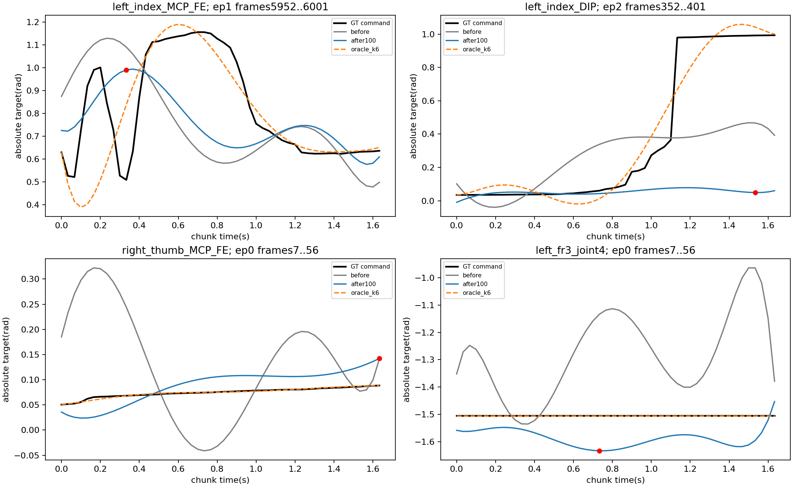
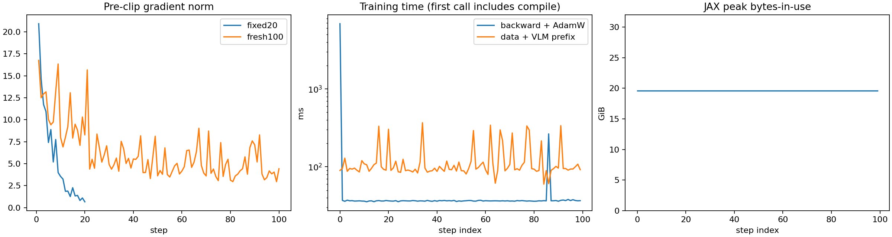

# P2：normal 真实数据受控离线训练

日期：2026-11-03。工作区 `/home/user/tomato-openpi-paper-flash`，分支 `paper-flash-test`，起始提交 `abfc6298bb14c157a673f56afd827c06c1d493e2`。沿用 P1 模型和数学实现；P0/P0.5/P1 结果保留。

## 结论与适用范围

固定真实 Batch 可拟合，独立初始化的 100 步训练 Loss 下降，固定 held-out 集物理动作误差改善。完整权重、Adam 状态及步数保存和恢复验证通过。工程上具备下一轮受控对照训练条件；当前结果不足以直接进入全量正式训练或部署：验证仅覆盖 3 个原始录制，手指瞬态漏预测与 Chunk 边界误差仍明显。

**本轮仅 K=6（7 个系数 token）、stride=1、30Hz、Absolute `(50,58)`、冻结 VLM。没有验证论文 stride=4 稀疏长时训练；没有 E0/E1/E2 等预算对照，不宣称优于 main。** 未修改 main、Delta 分支或实机接口，没有发布机器人动作。

## 数据加载、划分与因果语义

来源：`ssh://28/mnt/data/train_platform/datasets/tomato_sharpa/normal`。只读读取已发布 LeRobot 元数据、数值列和当前 RGB 帧；排除 hidden/ingest/production/conversion 及视频目录递归。全量目录快照含 10 个数据根、496 个 Episode、538,722 帧，不再以 P1 的 3 个 Episode 充当训练集。这里“全量快照”指已发布目录快照，未包括未发布原始录制。

| normal 数据根（相对 normal/） | Episode | 帧数 |
|---|---:|---:|
| no-block-more/A/1102_588_616_normal_lerobot | 3 | 19,854 |
| no-block-more/B/1101_572_601_normal_lerobot | 7 | 38,200 |
| no-block-more/B/1103_604_632_normal_lerobot | 6 | 29,398 |
| no-block-one/10.16before | 169 | 157,064 |
| no-block-one/A/1022_121_430_normal_lerobot | 168 | 157,442 |
| no-block-one/A/1022_54_120_normal_lerobot | 41 | 37,145 |
| no-block-one/A/1026_444_513_normal_lerobot | 47 | 37,240 |
| no-block-one/B/1022_130_423_normal_lerobot | 34 | 40,221 |
| no-block-one/B/1022_56_106_normal_lerobot | 8 | 10,607 |
| no-block-one/B/1026_446_510_normal_lerobot | 13 | 11,551 |

- 采用 `meta/episodes.jsonl` 的真实 `source_recording_id` 分组，seed=42，约 20% 留出；预先指定 2 个旧瞬态源和 1 个完整 Episode 源进入验证，固定 Batch 源进入训练。最终 395 个训练源、101 个验证源，本快照每源对应 1 个 Episode。分组函数也测试了多 Episode 共用源 ID 的情况。
- 全部 395 个训练 Episode 的 426,785 行用于 Action 和 State 的 q01/q99；验证集冻结使用相同统计。Action 使用主干仿射规则，epsilon=1e-6，不裁剪；历史 measured position 使用 Action 统计以匹配系数源空间，prompt 中当前 State 使用训练 State 统计。系数沿用 P1 的 Legendre 伪逆行范数缩放，无验证集系数统计。
- 训练采样 seed=42001，从所有有效训练窗口均匀无放回取 100 个当前帧，实际覆盖 81 个 Episode。Microbatch=1，effective batch=1，没有梯度累积。
- 固定 Batch：`8fc6041fb6830400` frame302。验证：完整 Episode `7f7e5279898aa902` 的 24 个非重叠 Chunk，加两个瞬态 Episode 各 2 个相邻 Chunk，共 28 窗口、25 个同 Episode 邻接对。这里只评估 101 个验证源中的 3 个，不是完整验证集指标。
- 每窗历史 `(8,58)` 是实测 `observation.state` position `[t-7,t]`；当前 RGB/语言/State 均来自 t。扩展监督 `(54,58)` 是 Absolute command `[t-2,t+51]`，执行输出 `(50,58)` 对应 `[t,t+49]`。要求 t>=7 且 t+51<episode_rows，不跨 Episode、不补未来帧。未来 command 仅在 loss/Oracle API 中出现，采样 API 无 target 参数。
- 真实三相机：cam0 base、cam2 left wrist、cam1 right wrist；按视频 PTS 精确定位当前 frame，PNG 缓存含哈希。使用实际 task_index 对应英文 prompt 和 PaliGemma tokenizer，未以合成图像替代。冻结 VLM、关闭图像增强，因此可缓存验证 prefix/KV；训练仍对每个当前观察编码。
- 因果测试修改未来 actions/states，历史输入保持逐项相同。全部 496 Episode 的 Action+State 完整轨迹哈希审计未发现跨集合完全重复轨迹；分组源 ID 交集为空。此检查不能排除被赋予不同 ID 的非完全相同录制别名。

训练英文 prompt 示例：

> Pick up a tomato truss with the right hand, then pick a cherry tomato with the left hand and place it in the left basket.

每个数据根的完整 task 表、原始录制标识、Episode/路径/长度/数值缓存哈希见 [manifest.json](results/p2/manifest.json)，逐窗索引见 [window_plan.json](results/p2/window_plan.json)，划分见 [split.json](results/p2/split.json)。

| 指纹 | SHA256 |
|---|---|
| Dataset Manifest | `1f34247c7461a4a8d18809798e75b1b1226a8e877fd3d524852a0d8e059dddbc` |
| Source Split | `0dbf81403fa65edceeef021d8ebf19f61ef85a498300ec33b14feafcf6548a84` |
| 训练统计逻辑指纹 | `effbcaf2e7d79cf061385ed0983a57052778dcecbdcbff7e06b9dac517bc9e76` |
| 归一化 JSON 内容快照 | `f57f5a99304c45d44e1f614d7604a758253730c79f6c9a3054a8ce02297ca4fb` |
| Window Plan | `841f7b2ac8412e8a55d3bcaa90308fdf6bb59931f3602e18abc11a727105ad4c` |

统计逻辑指纹继承 P1 的 float64 分位数计算定义；内容快照是实际序列化归一化 JSON 的哈希，两者定义不同。详见 [normalization.json](results/p2/normalization.json) 和 [data_integrity_audit.json](results/p2/data_integrity_audit.json)。

## 优化器、冻结与预算

实验配置 `pi05_flash_k6_stride1_normal_p2_frozen_vlm`；复用 `Pi0Flash`、`FlashPolynomial`、`flash_data.py`，没有重复实现 P1。AdamW 沿用当前工程默认 b1=0.9、b2=0.95、eps=1e-8、weight_decay=1e-10，global gradient norm clip=1.0。常数 LR=2.5e-5，取 main 峰值；100 步诊断不沿用 main 的 1000 步 warmup，避免整个预算都处于近零学习率。该选择需要在后续对照中保持可比，不能与 main 原 schedule 的结果直接作算法优劣结论。

模型 seed=42、flow seed=42002。训练 FM 和 Consistency 权重 1:1，历史源训练噪声 std=0.5，验证/采样无源噪声。固定 Batch 为诊断刻意固定同一个 flow random draw；下降证明能拟合这一个目标与采样，不等于多随机源的完全过拟合。固定 20 步后将 Expert 恢复到原始初始化并重置 Adam step/moments，再做独立 100 步，不把固定 Batch 训练收益带入正式曲线。

加载 `/home/user/checkpoints/pi05_base/params`，复用原 prefix/KV conditioning、预训练 VLM 和兼容的 Expert/time MLP 权重；58D 输入输出投影单独初始化。VLM 2,923,335,408 参数冻结，Expert/time/projection 430,151,738 参数训练。权重保留 float32，Transformer 计算 bfloat16。训练前后 VLM SHA256 完全一致：

`de5ce5077e3f8e7f6dc08bec28893027c9a3aa486ff4dc4d43218a24f7f33324`

## 固定 Batch 和训练曲线

| 项目 | 初始 | 最终 |
|---|---:|---:|
| 固定 Batch FM | 1.90045047 | 0.00593723 |
| 固定 Batch Consistency | 2.76324868 | 0.00608949 |
| 固定 Batch Total | 4.66369915 | 0.01202673 |
| 100 步训练 FM（首/末 10 步均值） | 1.21984646 | 0.57620002 |
| 100 步训练 Consistency（首/末 10 步均值） | 1.52045045 | 0.49356497 |
| 100 步训练 Total（首/末 10 步均值） | 2.74029686 | 1.06976499 |
| Validation FM | 1.44305672 | 0.58021717 |
| Validation Consistency | 2.29439502 | 0.54590230 |
| Validation Total | 3.73745173 | 1.12611946 |

固定 Batch 总 Loss 降低约 99.74%。100 步训练随机窗口 Loss 有波动，使用首末 10 步均值判断趋势。每 20 步对相同观察、历史和验证 flow 时间采样评估；训练包含源噪声而验证不含，不能把两种 Loss 逐值直接等同。没有 OOM、NaN/Inf；全部训练梯度有限。



原始逐步数据见 [fixed_curve.csv](results/p2/fixed_curve.csv)、[training_curve.csv](results/p2/training_curve.csv)、[validation_curve.csv](results/p2/validation_curve.csv)。

## 验证物理动作误差

在反归一化后的 58D Absolute command 空间计算，单位 rad；P95/P99 为绝对误差分位数，RMSE 保留平方误差。双臂 14D 由关节名识别，左右臂在 canonical ORDER 中并不连续，不能简单取前 14 维。

| 分组/方法 | MAE | RMSE | P95 | P99 | Max |
|---|---:|---:|---:|---:|---:|
| 全部58D/训练前 | 0.168197 | 0.228178 | 0.475057 | 0.673319 | 1.468023 |
| 全部58D/100步 | 0.073902 | 0.118092 | 0.270173 | 0.438267 | 0.959654 |
| 全部58D/GT K6 Oracle | 0.001039 | 0.006332 | 0.004074 | 0.014734 | 0.545172 |
| 双臂14D/训练前 | 0.261339 | 0.320994 | 0.604528 | 0.840885 | 1.443950 |
| 双臂14D/100步 | 0.099737 | 0.137375 | 0.298706 | 0.395339 | 0.959654 |
| 双臂14D/GT K6 Oracle | 0.000554 | 0.001610 | 0.002668 | 0.007634 | 0.025760 |
| 双手44D/训练前 | 0.138561 | 0.189332 | 0.402786 | 0.565887 | 1.468023 |
| 双手44D/100步 | 0.065681 | 0.111257 | 0.240489 | 0.450426 | 0.942866 |
| 双手44D/GT K6 Oracle | 0.001193 | 0.007213 | 0.004592 | 0.017784 | 0.545172 |

**Oracle 用未来 GT 拟合，代表当前受约束 K6 表示的参考误差，不是模型预测，也不是所有指标的理论最优下界。** Oracle 与模型的训练标签均使用 P1 官方形式的边界约束。整体误差差距显示当前主要仍有学习不足；少数瞬态 Oracle 本身也有不可忽略的表示误差。



逐关节 58D × before/after100/oracle 的 MAE、RMSE、P95、P99、Max 见 [per_joint_errors.csv](results/p2/per_joint_errors.csv)。逐窗口路径/源 ID/帧区间见 [validation_windows.csv](results/p2/validation_windows.csv)。

### 关键手指和失败案例

- 最严重手部模型误差：normal `no-block-more/A/1102_588_616_normal_lerobot`，Episode2，原始源 `435fc6da99284d7ba15cf09193352c06`，frames352..401，`left_index_DIP` 在 frame398 绝对误差 0.942866 rad；该关节该窗 P95=0.939987、P99=0.942792、RMSE=0.527715 rad。GT 后半段迅速接近 1 rad，模型仍接近零，属于明显漏预测；同窗 Oracle 最大误差 0.312958 rad，表示平滑有影响，但不足以解释模型全部失败。不能只归因于 K6。
- 同一 Episode frames402..451，`left_index_DIP` 最大误差 0.568140 rad（frame447）；`left_ring_MCP_FE` 最大 0.485847 rad。不能用全体手部均值掩盖这些局部错误。
- 原始源 `e4bdeafd7d834062bfba2ad01049a5b8`，Episode1 frames5952..6001，`left_index_MCP_FE` 的 GT 急变使 K6 Oracle 在 frame5957 仍有 0.545172 rad 误差，当前平滑多项式表示确有瓶颈。训练后轨迹幅度和相位也不完全正确。
- 完整验证 Episode 的平缓手指和双臂轨迹有明显改善，但部分关节仍偏移。此轮没有加入 adaptive K、分组阶数或残差以掩盖问题。

6 个预先关注 Sharpa 关节 × 4 个瞬态窗口 × 3 种方法的 P95/P99/Max 与峰值帧见 [critical_fingers.csv](results/p2/critical_fingers.csv)。同一观察训练前后轨迹及 Oracle 如下，红点为 after100 最大误差位置：



## 相邻 Chunk 实际连续性

比较相隔 50 帧的两个真实当前观察，位置 gap 为前窗多项式 tick50 减后窗 tick0，即同一个物理时刻；速度 gap 为两侧解析导数（rad/s）。没有把前窗离散第49步到后窗第0步的正常采样间隔当作不连续。历史使用记录的真实 measured state，是离线 teacher-forced 观察序列；未进行模型动作闭环 rollout。

| 分组 | 位置 MAE 前→后(rad) | 位置 Max 后(rad) | 速度 MAE 前→后(rad/s) | 速度 Max 后(rad/s) |
|---|---:|---:|---:|---:|
| 全部 | 0.414726 → 0.130409 | 0.890014 | 5.501202 → 1.034436 | 6.476752 |
| 双臂 | 0.644989 → 0.232078 | 0.872070 | 10.113854 → 1.870358 | 6.476752 |
| 双手 | 0.341461 → 0.098059 | 0.890014 | 4.033539 → 0.768461 | 6.094198 |

Gap 虽下降，仍显著。官方形式的 C¹ KKT 投影约束的是**训练目标**端点与中心差分速度；采样不能传入未来端点标签，模型系数预测因此不保证严格 C¹。不能把目标约束矩阵残差小解释为已学模型连续。实际 gap 已独立测量，上表不作安全执行保证。

## 性能、完整 Checkpoint 与可复现性限制

RTX5090 32GB。JAX `peak_bytes_in_use`=21,021,634,816 bytes（19.58 GiB），分配器 pool=28.20 GiB；这不是 NVML 整卡峰值。首次 fresh update 编译加执行 6.874s，后续 backward+AdamW 中位数 36.57ms，数据读取/预处理+VLM prefix 中位数 94.74ms。稳定一步两段耗时约 131ms，不含周期验证和 Checkpoint I/O。

同步热推理中位数 45.38ms（5 次，44.88..45.73ms），包括三 RGB 的 VLM prefix、NFE1 和重建，不含磁盘解码/tokenizer。不是机器人端到端延迟。



完整 Checkpoint：`/home/user/tomato-openpi-paper-flash/.cache/flash_p2_checkpoint_100_recovered`（约15GB，参数约12GB+Adam约3.4GB+metadata），只保存一份有效最终完整模型。含 step100、模型配置、完整 Normalization、Split、Window Plan、Manifest Hash、Optimizer 配置和 moments。没有复制历史 Checkpoint，没有将权重或原始数据上传 Git。

- 参数保存/恢复 SHA256：`6b3d9f3ad26b3db2b123af86f56d45e21ec57c83c366e50ad69711d42e437a73`。
- Adam/step typed state SHA256：`5d4b7f09e55210477f1c9085321771f9d1c9a5131a655400bf2c8979aa7d964f`。
- Orbax 恢复 optimizer 改为 host numpy，随后显式 `jax.device_put`；typed NNX 反序列化后再哈希，避免 JSON 将整数 key 转为字符串造成假不一致。小型 Adam 测试验证恢复后下一次更新与未中断版本完全一致；完整模型恢复验证没有增加更新。
- 完整恢复采样 `(1,50,58)`、全部有限。跨进程推理相对保存轨迹 max差0.004973 rad、平均差0.000680 rad；权重/Adam 哈希精确相同，不把浮点输出描述为逐位复现。混合精度 GPU 数值路径可能相关，具体差异来源尚未完全隔离。

### 中断恢复与实际执行预算

首次运行 `.cache/flash_p2_run_01` 已完成固定20+fresh100和所有评估，但用户中断发生在最终写权重期间，留下约2.1GB的未完成 `.cache/flash_p2_checkpoint_100`，未删除、覆盖或视为有效 Checkpoint。为得到对应完整模型，从同一初始权重/配置/窗口顺序回放：第一次严格数值检查在第1步失败（Loss相差约0.1%）后停止；第二次完成100步并成功保存。最终参数只走到 step100，没有在100步模型上追加到200步。

**实际累计执行更新为 20+100+1+100=221 次**，其中恢复额外重复计算101次，超出最初20+100的总计算次数；这是中断恢复开销，不应隐去或称总共只执行120次。恢复跳过已通过的固定20步，未改变超参或根据验证择优。最终报告的训练前/后与中间验证曲线均来自 `.cache/flash_p2_recovery_02`；固定20步结果来自原运行并明确分开。恢复100个窗口索引相同，逐步最大Loss差0.029827，不能称为数值精确回放。

原始运行记录和最终恢复记录均保留本地；首次运行的派生记录另存 [original_interrupted_result.json](results/p2/original_interrupted_result.json)，数值差和预算记录见 [training_result.json](results/p2/training_result.json)。W&B 先 offline 再 sync；最终恢复运行 [91l0xgki](https://wandb.ai/mengxiangzhang-bit/openpi-flash/runs/91l0xgki)，原始固定20和首次100步 [am18y5rk](https://wandb.ai/mengxiangzhang-bit/openpi-flash/runs/am18y5rk)。恢复 run 的 W&B 曲线不包含重新执行的固定20步，本报告固定图明确来自原运行。

## 新增/修改文件与验证

- 新增 `src/openpi/training/flash_dataset.py`：持续真实 Episode 窗口、源分组、真实图像与语言、严格因果历史。
- 新增 `scripts/flash/prepare_p2.py`、`prepare_p2_images.py`：冻结 normal 清单、Split、训练统计及100/28窗口索引，预缓存当前帧。
- 新增 `scripts/flash/train_p2.py`：20/100硬预算、固定拟合门禁、独立重置、冻结VLM AdamW、实际验证/日志和一次完整保存恢复；包含显式中断回放选项。未接入生产训练/部署入口。
- 新增 `scripts/flash/verify_p2_checkpoint.py`：现有完整模型与优化器零更新恢复和采样审计。
- 新增 `scripts/flash/report_p2.py`、`test_p2.py`：派生曲线/逐关节误差、源划分与历史因果/完整数据索引/Adam下一步恢复测试。
- 修改 `src/openpi/training/flash_checkpoint.py`：optimizer host恢复；P1模型、数学和原始基线算法文件未改。更新根 README，新增本报告与 `results/p2/` 元数据/派生图表。

最终 CPU 测试：`26 passed, 8 warnings`（已有 JAX/Flax 弃用提示）；Ruff 检查和格式检查通过。GPU 实测为固定20、fresh100、真实验证、状态哈希与最终采样，未用 CPU 合成测试替代训练结果。

## 实际命令

在实验工作区运行，使用既有虚拟环境，没有系统级安装。下面是本轮实际路径；训练入口拒绝覆盖已存在输出/Checkpoint，复跑必须选新的输出目录。

```bash
cd /home/user/tomato-openpi-paper-flash
export PYTHONPATH=src:packages/openpi-client/src:.
export XLA_PYTHON_CLIENT_PREALLOCATE=false
export XLA_PYTHON_CLIENT_MEM_FRACTION=0.90
export OPENBLAS_NUM_THREADS=1
PY=/home/user/sharpa-pi05/.venv/bin/python
$PY scripts/flash/prepare_p2.py --output .cache/flash_p2_data
$PY scripts/flash/prepare_p2_images.py --data .cache/flash_p2_data --images .cache/flash_p2_images
$PY scripts/flash/train_p2.py --data .cache/flash_p2_data --images .cache/flash_p2_images \
  --output .cache/flash_p2_run_01 --checkpoint .cache/flash_p2_checkpoint_100
# 首次 strict replay 使用 recovery_01；保留失败记录。最终恢复命令：
$PY scripts/flash/train_p2.py --data .cache/flash_p2_data --images .cache/flash_p2_images \
  --output .cache/flash_p2_recovery_02 --checkpoint .cache/flash_p2_checkpoint_100_recovered \
  --replay-result .cache/flash_p2_run_01/result.json
# 修复 Orbax/NNX key 检查后，只验证已保存模型，不训练：
$PY scripts/flash/verify_p2_checkpoint.py --run .cache/flash_p2_recovery_02 \
  --checkpoint .cache/flash_p2_checkpoint_100_recovered \
  --data .cache/flash_p2_data --images .cache/flash_p2_images
$PY scripts/flash/report_p2.py --run .cache/flash_p2_recovery_02 \
  --data .cache/flash_p2_data --output docs/flash/results/p2
JAX_PLATFORMS=cpu $PY -m pytest scripts/flash -q
/home/user/sharpa-pi05/.venv/bin/ruff check scripts/flash/*p2*.py \
  src/openpi/training/flash_dataset.py src/openpi/training/flash_checkpoint.py
/home/user/sharpa-pi05/.venv/bin/ruff format --check scripts/flash/*p2*.py \
  src/openpi/training/flash_dataset.py src/openpi/training/flash_checkpoint.py
git diff --check
WANDB_MODE=online /home/user/sharpa-pi05/.venv/bin/wandb sync \
  .cache/flash_p2_recovery_02/wandb/offline-run-20261103_143348-91l0xgki
WANDB_MODE=online /home/user/sharpa-pi05/.venv/bin/wandb sync \
  .cache/flash_p2_run_01/wandb/offline-run-20261103_142300-am18y5rk
```

后续首先扩大固定 held-out 覆盖、复核手部瞬态与跨 Chunk 实际误差，再在同 Split/归一化/预算下运行 E0/E1/E2。此报告不启动后续训练。
