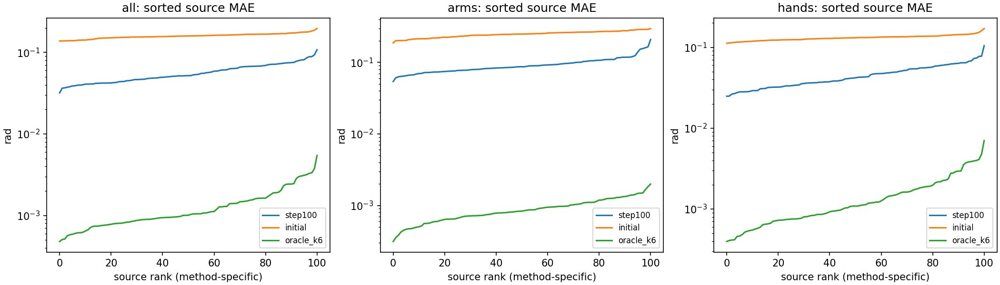
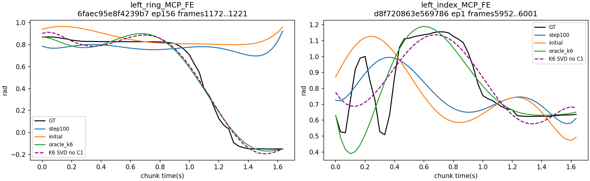
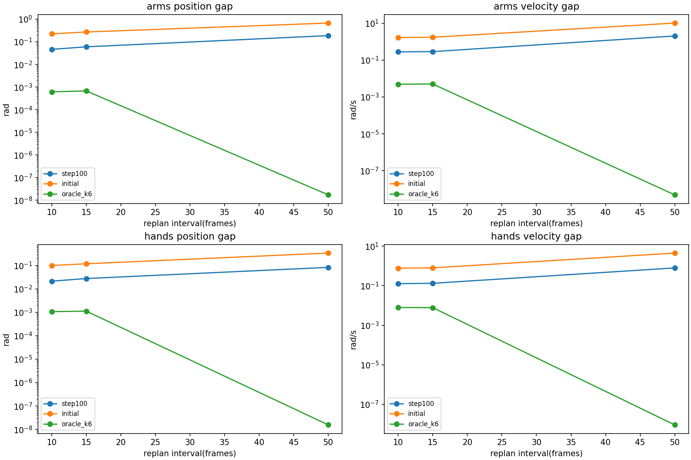

# FLASH P2.5：扩大离线验证与 P3 候选方案

2026-11-03；工作区 `/home/user/tomato-openpi-paper-flash`，分支 `paper-flash-test`，起始提交 `a3ecb57f2fe63a836875168f626a257efa134f10`。本轮优化器更新 **0**，不生成/覆盖模型 Checkpoint。P0/P0.5/P1/P2 结果和 Step100 Checkpoint 保留。

## 1. 扩大验证后的判断

Step100 相比参数精确重建的初始 FLASH 模型，在全部 **101 个冻结验证源、813 个唯一窗口、9 个数据根**上，58D MAE 从 **0.159346** 降至 **0.056757 rad**，RMSE 从 **0.223032** 降至 **0.094429 rad**。

按原始源分别统计，全部动作/双臂/双手 MAE 改善的源分别为 **101/101、101/101、101/101**。这支持在更广覆盖上存在学习收益，但不代表每个窗口、关节或所有指标都改善；这也不是与 main 原始 π₀.₅ 的对照结论。

建议下一轮先从真实 Step100 状态进行**受控 Step250**验证，通过门禁再到 Step500，Step1000 保留为候选节点；本轮未启动 P3。手指瞬态、部分臂部幅度偏差及重规划连续性仍需重点观察；不建议直接无门禁全量训练或实机部署。

## 2. 数据、分层方式与可复现性

沿用 P2 normal-only 数值缓存与源级 Split，不读取 raw/speedup 作为本轮训练或评估样本，不重新划分。数据来源 `ssh://28/mnt/data/train_platform/datasets/tomato_sharpa/normal`；395 个训练源、101 个验证源和训练集统计保持原样。

| 冻结项 | SHA256 |
|---|---|
| P2 Manifest | `1f34247c7461a4a8d18809798e75b1b1226a8e877fd3d524852a0d8e059dddbc` |
| P2 Source Split | `0dbf81403fa65edceeef021d8ebf19f61ef85a498300ec33b14feafcf6548a84` |
| P2 Normalization 逻辑指纹 | `effbcaf2e7d79cf061385ed0983a57052778dcecbdcbff7e06b9dac517bc9e76` |
| Normalization JSON 内容 | `f57f5a99304c45d44e1f614d7604a758253730c79f6c9a3054a8ce02297ca4fb` |
| P2.5 Evaluation Plan | `1c6d4685fd296f48722ec11072f067dd51537a595214751bda726da4678fbbb6` |

对每个验证 Episode，在有效锚点网格（步长5帧）上，根据实测手部未来49个帧差的最大绝对速度，分别选取最小值与最大值作为相对平缓/瞬态锚点，二者至少相距50帧；每个锚点添加 +0/+10/+15/+50 窗口，并保留 P2 已知两处瞬态锚点。共204组锚点，每种重规划间隔204对；去重后813个窗口。**这里网格5只用于选择评价锚点，模型动作采样 stride 始终为1。**

这是有意覆盖动作两端的诊断性分层样本，锚点选择使用 GT measured state 的动作强度，不使用模型结果；不是整个验证集所有帧的均匀随机平均误差。窗口之间有重叠，不能把813窗视为813个独立原始样本。全部101源覆盖不等于完整遍历每个源的每一帧。

| 验证数据根（相对 normal/） | 原始源 | 唯一窗口 |
|---|---:|---:|
| no-block-more/A/1102_588_616_normal_lerobot | 2 | 23 |
| no-block-more/B/1103_604_632_normal_lerobot | 2 | 16 |
| no-block-one/10.16before | 32 | 256 |
| no-block-one/A/1022_121_430_normal_lerobot | 33 | 262 |
| no-block-one/A/1022_54_120_normal_lerobot | 12 | 96 |
| no-block-one/A/1026_444_513_normal_lerobot | 9 | 72 |
| no-block-one/B/1022_130_423_normal_lerobot | 8 | 64 |
| no-block-one/B/1022_56_106_normal_lerobot | 2 | 16 |
| no-block-one/B/1026_446_510_normal_lerobot | 1 | 8 |

冻结验证 Split 只含上述9根，原快照第10根没有验证源，本轮不为补齐该根而改 Split。所有验证元数据只有同一个任务描述，无法声称覆盖多种任务类型。实际英文 prompt：

> Pick up a tomato truss with the right hand, then pick a cherry tomato with the left hand and place it in the left basket.

每窗仍为真实当前 cam0/cam2/cam1 RGB、当前离散 State prompt、测量历史 `[t-7,t]` 的 `(8,58)`，扩展 command 标签 `[t-2,t+51]` 的 `(54,58)`，最终输出 `[t,t+49]` 的 `(50,58)`。所有窗满足 Episode 边界；未来目标只传给监督/Oracle/离线统计。Observation、历史和目标逐窗内容哈希在两个模型进程一致。

窗口与源/根/Episode/帧索引见 [evaluation_plan.json](results/p25/evaluation_plan.json)，P2 Manifest/Split/Normalization 引用 [P2 冻结记录](results/p2/)。本轮没有复制数据集或权重到 Git。

## 3. 三种方法的物理动作误差

- Step100：只读恢复 `.cache/flash_p2_checkpoint_100_recovered`，单步 Flow 推理。
- Initial：复用 P2 的 `load_model`、相同预训练权重、seed42和58D投影初始化；Expert 与 VLM 哈希分别匹配 P2 初始记录，属于参数精确重建。浮点输出仍受跨进程计算漂移影响。
- Oracle K6：未来 GT 拟合，沿用 P1 官方形式的 C¹ 目标投影，仅作为表示误差参考。它不进入模型的 prefix、KV、历史或推理输入。

K=6 为6阶、7个系数 token，stride=1、30Hz、Absolute 58D，VLM冻结。未引入 Adaptive K、分组阶数、Delta、触觉或RTC，没有论文 stride=4 稀疏长时训练结论。

| 方法/分组 | MAE | RMSE | P95 | P99 | Max（rad） |
|---|---:|---:|---:|---:|---:|
| Initial/58D | 0.159346 | 0.223032 | 0.456701 | 0.726598 | 2.294213 |
| Initial/双臂14D | 0.247585 | 0.320319 | 0.641896 | 0.943321 | 2.294213 |
| Initial/双手44D | 0.131270 | 0.181449 | 0.377140 | 0.549217 | 1.706714 |
| Step100/58D | 0.056757 | 0.094429 | 0.195674 | 0.367536 | 1.140139 |
| Step100/双臂14D | 0.092640 | 0.136109 | 0.294793 | 0.478852 | 1.140139 |
| Step100/双手44D | 0.045339 | 0.076547 | 0.154464 | 0.282868 | 1.070027 |
| GT K6 C1 Oracle/58D | 0.001344 | 0.006226 | 0.005902 | 0.021831 | 0.545172 |
| GT K6 C1 Oracle/双臂14D | 0.000900 | 0.002340 | 0.004393 | 0.010608 | 0.055567 |
| GT K6 C1 Oracle/双手44D | 0.001485 | 0.007025 | 0.006670 | 0.025946 | 0.545172 |

上表为所选唯一窗口的物理量 pooled 统计。每个源和每个数据根另按其所有所选帧重新聚合，不用平均 RMSE 代替真实平方误差统计。逐关节 P95/P99/Max 见 [per_joint.csv](results/p25/per_joint.csv)，逐源（本快照一源一Episode）见 [per_source.csv](results/p25/per_source.csv)，逐根见 [per_root.csv](results/p25/per_root.csv)，逐窗见 [per_window.csv](results/p25/per_window.csv)。

| 分组 | 改善源数 | 等权源 MAE 变化（后−前） | 源级 Bootstrap 95%区间 | 最差源 MAE 变化 |
|---|---:|---:|---|---:|
| 全部 | 101/101 | -0.102773 | [-0.106142, -0.099572] | -0.066165 |
| 双臂 | 101/101 | -0.155169 | [-0.160826, -0.149431] | -0.086725 |
| 双手 | 101/101 | -0.086102 | [-0.088870, -0.083376] | -0.056561 |

按数据根聚合的Step100误差较高者如下；每根源数不同，不据此归因于采集条件：

| 数据根 | MAE | RMSE（rad） |
|---|---:|---:|
| no-block-one/B/1022_56_106_normal_lerobot | 0.072796 | 0.123341 |
| no-block-one/A/1022_54_120_normal_lerobot | 0.071533 | 0.118468 |
| no-block-more/A/1102_588_616_normal_lerobot | 0.070344 | 0.119716 |
| no-block-one/10.16before | 0.065879 | 0.103197 |

Bootstrap 以原始源为抽样单位、seed42、2000次；只描述当前分层窗口的跨源差异，不是对未见任务或实机成功率的置信声明。下图每个方法独立排序，rank 不代表同一源的配对；真正配对改善计数在上表和 CSV。



## 4. 主要失败与 K6 表示瓶颈

- Step100 最差手部点：`left_ring_MCP_FE`，源 `/home/user/company-remote-2/real/harvest-tomato/origin-sharpa/10.16之前数据/episode368`，`no-block-one/10.16before`，Episode156，窗frames1172..1221，峰值frame1221，误差 **1.070027 rad**。
- GT C1 Oracle 最差手部点：`left_index_MCP_FE`，源 `e4bdeafd7d834062bfba2ad01049a5b8`，`no-block-more/A/1102_588_616_normal_lerobot`，Episode1，窗frames5952..6001，峰值frame5957，误差 **0.545172 rad**。

该左无名指窗口GT后半段由约0.8 rad张开到约−0.16 rad，Step100仍维持较高屈曲值；同窗该关节C1 Oracle最大误差仅0.116461 rad（峰值frame1221处为0.002588 rad），因此该主要失败属于预测/学习不足，不能以低阶表示解释。

双臂主要尾误差为 `left_fr3_joint7`（P99=0.755696、Max=1.140139 rad）、`left_fr3_joint4`（P99=0.571916）、`right_fr3_joint5`（P99=0.530984）。全体最大误差出现在 `no-block-one/A/1022_121_430_normal_lerobot` Episode52、窗662..711的 `left_fr3_joint7`，峰值frame711。

| Step100 高 P99 手关节 | P95 | P99 | Max（rad） |
|---|---:|---:|---:|
| left_ring_MCP_FE | 0.368190 | 0.737035 | 1.070027 |
| left_pinky_MCP_FE | 0.253408 | 0.603988 | 0.906998 |
| left_middle_MCP_FE | 0.247420 | 0.413336 | 0.939497 |
| left_index_MCP_FE | 0.224700 | 0.407909 | 0.898483 |
| right_index_MCP_FE | 0.229727 | 0.393418 | 0.882876 |

关键6个 Sharpa 手指的所有瞬态窗口单独输出 [critical_fingers.csv](results/p25/critical_fingers.csv)；每种方法最差20窗及准确峰值关节/帧见 [worst20_windows.csv](results/p25/worst20_windows.csv)。重叠窗口的同一个急变会出现多次，不能将其计为多个独立失败录制。

为区分6阶限制和边界投影的影响，另做**纯离线 float64 SVD 无 C¹ K6 拟合**，不替换模型或标签。比较如下：

| 表示参考/分组 | MAE | RMSE | P99 | Max（rad） |
|---|---:|---:|---:|---:|
| 当前C1 Oracle/arms | 0.000900 | 0.002340 | 0.010608 | 0.055567 |
| 当前C1 Oracle/hands | 0.001485 | 0.007025 | 0.025946 | 0.545172 |
| 无C1 SVD参考/arms | 0.000705 | 0.001841 | 0.008332 | 0.040037 |
| 无C1 SVD参考/hands | 0.001156 | 0.005755 | 0.020112 | 0.337027 |

Oracle 不是模型预测，也不是任意指标下的理论最优下界：C¹ 投影为端点/中心差分导数付出拟合代价，而无约束 SVD 优化的是完整54点的 L2，并非50执行点的 Max。整体上模型误差高于 Oracle，不能把欠学习全部归因于 K6；但急变处 Oracle 残差仍真实存在，平滑低阶表示及边界权衡不能被平均 MAE 掩盖。无约束拟合的逐窗结果见 [representation_windows.csv](results/p25/representation_windows.csv)。



## 5. 10/15/50 帧重规划连续性

每个间隔204对真实观察。+10比较旧窗tick10..49与新窗tick0..39；+15比较旧窗tick15..49与新窗tick0..34；+50比较旧窗tick50与新窗tick0。位置与解析速度均对齐同一物理时间；原始 GT 在相同时间位置逐项一致的断言通过。每种间隔覆盖的点数不同（40/35/1），不能当作同一统计量随时间平滑变化的定律。

| 方法/间隔 | 双臂位置 MAE | 双手位置 MAE | 双臂速度 MAE | 双手速度 MAE |
|---|---:|---:|---:|---:|
| initial/10帧 | 0.224814 | 0.100171 | 1.689909 | 0.777643 |
| initial/15帧 | 0.271339 | 0.118992 | 1.758456 | 0.803437 |
| initial/50帧 | 0.672142 | 0.341047 | 10.320447 | 4.515968 |
| step100/10帧 | 0.046332 | 0.021480 | 0.282364 | 0.127618 |
| step100/15帧 | 0.059980 | 0.027888 | 0.290994 | 0.133190 |
| step100/50帧 | 0.187357 | 0.083383 | 2.055290 | 0.798526 |
| oracle_k6/10帧 | 0.000616 | 0.001075 | 0.004946 | 0.007957 |
| oracle_k6/15帧 | 0.000677 | 0.001127 | 0.005078 | 0.007804 |
| oracle_k6/50帧 | 0.000000 | 0.000000 | 0.000000 | 0.000000 |

位置单位rad，速度单位rad/s。每组P95/P99/Max完整保存在 [results.json](results/p25/results.json)，逐对结果见 [replan_pairs.csv](results/p25/replan_pairs.csv)。Oracle 的50帧同刻边界可以接近数值零，因为目标 C¹ 投影约束了共享GT端点/导数；它在10/15帧重叠内部仍可能不一致。目标端点约束不保证模型预测端点满足约束。



### 历史与模型/表示的诊断分解

对后一观察额外预测一次：prefix使用后一真实观察，history暂保留前一锚点已测得的8帧；不使用未来标签。记旧预测为A、实际重预测为B、旧history下重预测为C，则同刻 `B−A=(B−C)+(C−A)`。前项描述在当前prefix下替换历史的作用，后项同时包含prefix变化、时间原点重置和模型相位变化，不能命名为纯VLM因果效应。各项取绝对值后不可相加为贡献百分比。

| Step100 间隔/分组 | 实际位置Gap MAE | 历史替换项 MAE | 旧历史重预测Gap MAE |
|---|---:|---:|---:|
| 10/arms | 0.046332 | 0.007052 | 0.045031 |
| 10/hands | 0.021480 | 0.002766 | 0.021309 |
| 15/arms | 0.059980 | 0.010197 | 0.057766 |
| 15/hands | 0.027888 | 0.003802 | 0.027635 |
| 50/arms | 0.187357 | 0.044184 | 0.180171 |
| 50/hands | 0.083383 | 0.021337 | 0.083149 |

详见 [history_attribution.csv](results/p25/history_attribution.csv)。结合模型与Oracle差距，可以区分“GT可拟合但模型没有预测好”与“当前表示在不同窗内部拟合不一致”；历史改变也是重预测输入变化来源。此分解不能证明历史噪声或单一模块是根因，需要后续等预算 E1/E2 消融。全部使用记录的实测历史，是离线重规划诊断，不是模型动作闭环，不代表实现RTC。

## 6. Step100 恢复、PRNG 和混合精度

参数SHA256：`6b3d9f3ad26b3db2b123af86f56d45e21ec57c83c366e50ad69711d42e437a73`。

Adam/step typed state SHA256：`5d4b7f09e55210477f1c9085321771f9d1c9a5131a655400bf2c8979aa7d964f`。

两次独立 Step100 读取均与 P2 保存前哈希匹配；NNX typed key恢复后验证 moments 和 step，Checkpoint 内各文件 size/mtime 清单在评估前后不变。没有保存新权重，没有调用 optimizer.update。Adam下一步的一致性沿用P2小型恢复测试，本轮不为测试而执行完整模型更新。

初始 Expert SHA256：`1fc8bdb2141690c32de37bb3491c9ce853a5a9f61f7b8fa0912b1f74486c2f5c`；初始与Step100的VLM均匹配 P2 冻结摘要 `de5ce5077e3f8e7f6dc08bec28893027c9a3aa486ff4dc4d43218a24f7f33324`。

同进程最初8个窗口重复 cached/fresh-prefix 推理的最大差均为0。跨进程相同32窗执行动作差：MAE **0.000742649**、P99 **0.003821639**、Max **0.010456920 rad**。

P2训练时评估图与本轮评估图在 4 个相同窗口上的差异：MAE 0.000790408、Max 0.007606745 rad。GT一致，参数哈希一致；这是数值计算差异，不是参数恢复丢失。

Transformer计算bfloat16、参数float32，多项式 contraction使用HIGHEST；跨进程差异可能涉及GPU编译/autotuning与混合精度计算路径，具体根因尚未隔离，不能断言已完全解释或保证bitwise续训。同进程确定性不能推导跨进程逐位一致。完整审计及环境见三份 `*_audit.json`。

### 221次累计计算与真正Step100

P2原固定20步后重置Expert和Adam；原fresh100步保存中断，第一次回放1步数值断言失败，最终另从原初始化回放fresh100步。实际计算20+100+1+100=221，但最终权重与Adam step都为100。恢复后下一更新应为101，而不是222。

P2训练用无状态 `fold_in(key(42002), global_step)`，再split为noise/time。候选下一flow key数据为 `[837265607,1489898847]`。模型初始化seed42、sampler seed42001；推理本身无随机源噪声。原Checkpoint没有独立保存flow seed/完整PRNG字段，**仅持有Checkpoint目录不足以自描述随机恢复**，须保留P2 result/代码以及本轮 [resume_audit.json](results/p25/resume_audit.json)；不往原Checkpoint补写元数据。

原sampler的一次 `choice(N,100,replace=False)`不能直接替换为`choice(N,1000)`后跳过前100。候选方案先重建原100索引及RNG调用后状态，断言与冻结P2计划相同，再从未用索引继续无放回取900个。此延伸是新声明的P3抽样策略，因为P2当时只定义到100步；不能称为恢复了不存在的历史未来顺序。

候选计划指纹 `8bb5395c9454991318f7af981cc784e3e93af2fe9f16e08ead312b6dc1f2a9c2`，首100条逐项不变，101..1000全为训练源、无重复且不越界；全局step101首窗 `{'id': 'aed5208e09f5a250', 'start': 172}`。文件 [p3_candidate_plan.json](results/p25/p3_candidate_plan.json) 仅含索引/RNG/配置，未加载执行训练。

## 7. P3建议和公平对照

| 节点 | 候选新增更新 | 门禁/交付 |
|---|---:|---|
| Step100 | 0，已保留 | 当前扩大验证基线 |
| Step250 | +150 | 完整恢复Adam+模型+外部随机计划，不重置优化器；比较相同813窗及逐源/局部误差 |
| Step500 | 再+250，条件执行 | Step250有限值、Loss/物理误差未明显恶化且关键局部误差趋势可解释 |
| Step1000 | 再+500，条件执行 | Step500改善稳定后再决定，不自动授权 |

候选保持K6/stride1、冻结VLM、Absolute50×58、microbatch=effective batch=1、原AdamW与常数LR2.5e-5；不增新模块。每步/区间记录Loss、gradient、时间和显存，异常立即停；只有参数不够，必须恢复真实Adam moments/count和global step。

为避免重复约12GB全量VLM，可在保留不可变Step100完整Checkpoint的前提下，P3后续存Expert+Adam及其依赖VLM hash的增量快照；这需要单独实现并验证完整恢复，不能把增量文件当作独立完整模型。本轮不实现续训入口或新Checkpoint格式。

E0/E1/E2公平性要求：

1. E0为main结构的Absolute58D/horizon50基线适配；E1为同一pi05+K6系数表示、无history anchor（明确Gaussian源）；E2为当前history-anchored版本。E1/E2共用相同拟合/归一化/边界目标，只切换源分布以隔离历史锚定。不能将不同目标的Consistency开关混成单一消融结论。
2. 三组从同一预训练权重和可复用投影初始化、相同训练起点与固定VLM策略开始，至少多个预先固定seed；不能拿已训练100步的E2对比刚初始化的E0/E1。P3的E2续训只用于学习可行性，不直接构成公平对照。
3. 同一源Split、训练统计、英文prompt/RGB/state、当前帧窗口顺序、batch/effective batch、AdamW/LR schedule和训练样本预算；同时记录optimizer step、样本数、GPU时长与峰值显存，避免把等step当作完全等计算。
4. E1/E2使用54点扩展监督，E0原始50点监督，额外端点上下文是算法监督差异，应明确披露；必要时另设统一监督上下文的边界消融，不能隐去这项优势。所有组在相同50执行点计算物理误差。
5. 主比较使用同窗物理量MAE/RMSE、逐关节尾误差、瞬态、重规划Gap及延迟；动作空间与系数空间原始FM Loss的尺度不同，不能直接跨表示比较数值大小。E1/E2使用相同NFE，E0同时报告匹配NFE和常用基线NFE的速度/误差。
6. 813窗为已审查诊断集合，后续多轮选模型会形成验证适配。正式结论需要预先固定独立未调参的测试源/窗口；不改当前冻结Split来“修复”结果，也不能把其事后称为独立测试。

## 8. 资源、代码和执行命令

RTX5090。Step100评价forward中位 66.04ms（含prefix与重建，不含数据读取；不等于P2热NFE benchmark）；813窗评价循环耗时 114.73s，含逐窗数据/哈希、Oracle和历史反事实。JAX peak_bytes_in_use=28,294,421,760（26.35GiB），不是NVML整卡峰值；评估函数编译布局不同，不能当作训练显存预测。真实当前图像2439张缓存用时约400s，未复制完整视频。

新增 `prepare_p25.py`（冻结分层/配对索引）、`evaluate_p25.py`（只读权重和零更新推理）、`report_p25.py`（三法/表示/连续性/漂移统计）、`plan_p3.py`（仅候选索引）、`test_p25.py`（同刻对齐、边界、真实源覆盖、训练前缀、SVD参考）。只更新README和新增本报告/派生结果，没有修改P1模型或P2训练数学。

测试：4项P2.5测试通过；全部FLASH测试30项通过，8条已有JAX/Flax弃用提示。Ruff check/format及Git whitespace检查通过。实际GPU评估输出全部有限，两个模型的输入内容哈希相同。

```bash
cd /home/user/tomato-openpi-paper-flash
export PYTHONPATH=src:packages/openpi-client/src:.
export OPENBLAS_NUM_THREADS=1
export XLA_PYTHON_CLIENT_PREALLOCATE=false
export XLA_PYTHON_CLIENT_MEM_FRACTION=0.90
PY=/home/user/sharpa-pi05/.venv/bin/python
JAX_PLATFORMS=cpu $PY scripts/flash/prepare_p25.py \
  --data .cache/flash_p2_data --images .cache/flash_p2_images \
  --output .cache/flash_p25 --prefetch
$PY scripts/flash/evaluate_p25.py --method step100 --limit 32 \
  --data .cache/flash_p2_data --images .cache/flash_p2_images \
  --plan .cache/flash_p25/plan.json --output .cache/flash_p25/step100_repeat32
$PY scripts/flash/evaluate_p25.py --method step100 \
  --data .cache/flash_p2_data --images .cache/flash_p2_images \
  --plan .cache/flash_p25/plan.json --output .cache/flash_p25/step100
$PY scripts/flash/evaluate_p25.py --method initial \
  --data .cache/flash_p2_data --images .cache/flash_p2_images \
  --plan .cache/flash_p25/plan.json --output .cache/flash_p25/initial
JAX_PLATFORMS=cpu $PY scripts/flash/plan_p3.py --data .cache/flash_p2_data \
  --output docs/flash/results/p25/p3_candidate_plan.json
JAX_PLATFORMS=cpu $PY scripts/flash/report_p25.py \
  --run .cache/flash_p25 --output docs/flash/results/p25
JAX_PLATFORMS=cpu $PY -m pytest scripts/flash -q
/home/user/sharpa-pi05/.venv/bin/ruff check scripts/flash/*p25.py scripts/flash/plan_p3.py
/home/user/sharpa-pi05/.venv/bin/ruff format --check scripts/flash/*p25.py scripts/flash/plan_p3.py
git diff --cached --check
```

准备/评估输出目录拒绝覆盖既有模型或评价输出；计划可验证后重用，图表可从忽略的本地预测NPZ重新生成。所有模型输出、图像和数值原数据保留 `.cache/flash_p25/`，Git仅提交元数据、派生统计和图表。本轮不执行P3，不连接机器人、不修改main或Delta。
