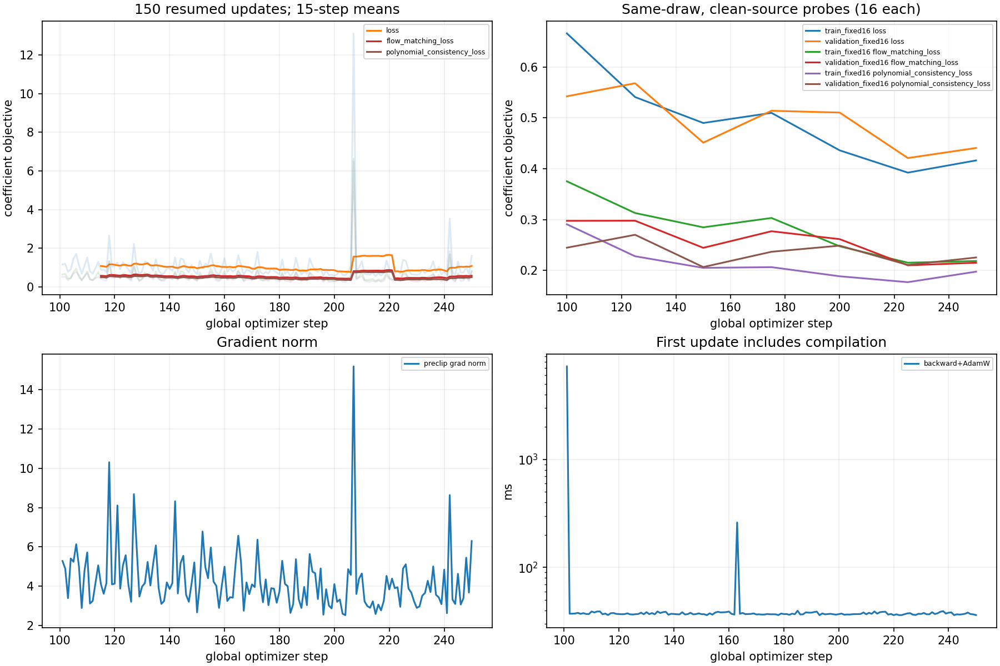
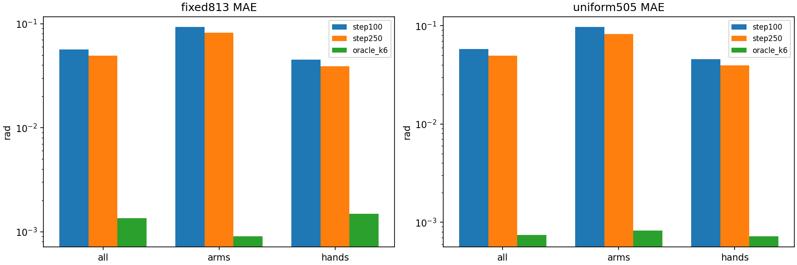
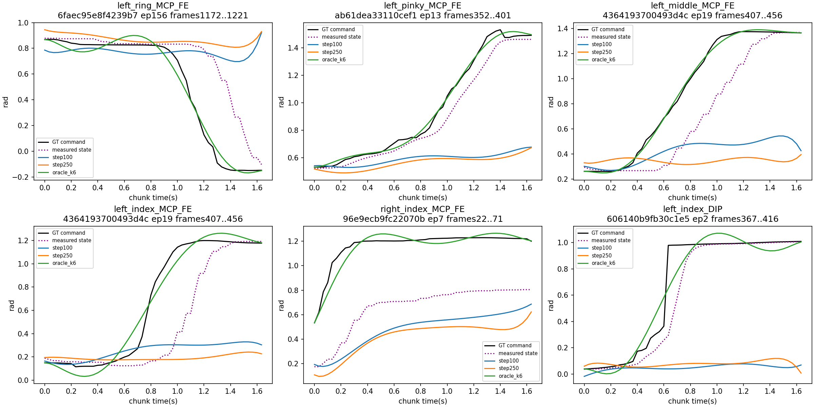
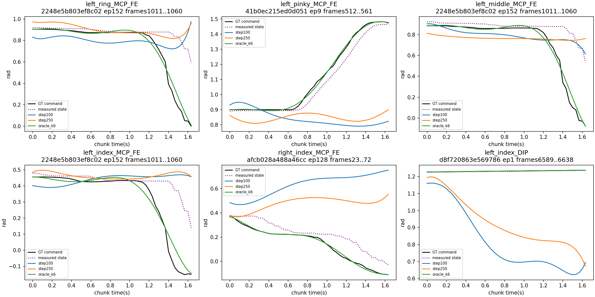
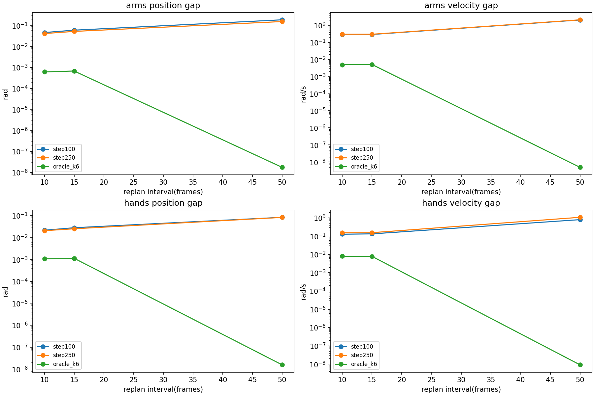

# FLASH P3：Step100 → Step250 受控续训

日期：2026-11-03（Asia/Shanghai）。工作区 `/home/user/tomato-openpi-paper-flash`，分支 `paper-flash-test`，起始提交 `534ed023542a20dad55e1827b0a5adad9b760d4d`。

## 结论与距离正式训练/部署的差距

已从真实 Step100 的参数与Adam moments/count恢复，完成 Step101..250；模型结构、K6/stride1、Absolute(50,58)、冻结VLM、数据Split/Normalization和LR保持不变。Step250恢复验证通过，未执行Step251。

这仍是学习与恢复链路的受控验证：最终模型只经历250个batch1训练窗口，不能当作全数据充分训练，更不能代替与main的E0/E1/E2对照。是否继续Step500应依据下面固定/均匀验证与局部误差共同判断，而不是依据单步Loss。

距离正式对照训练：本轮已封存Step250与验证，下一步需按验证门禁决定受控Step500，再冻结E0/E1/E2同起点、同数据/统计/窗口/预算和多seed方案。Step1000不是自动获准，也不是足以部署的固定步数。

距离部署至少还隔着三个独立验收块：①离线物理误差、关键手指瞬态和重规划连续性达到事先约定的机器人任务容差；②推理接口、时间戳/历史缓冲、动作单位/顺序/限位及回放行为验证；③另行授权下渐进式实机验证与任务成功率评估。本轮没有连接机器人或修改生产接口；现有离线误差不足以承诺部署日期或百分比。

本轮核心结果：固定813窗MAE **0.056757→0.049454 rad（改善12.87%）**、RMSE **0.094429→0.084896（改善10.10%）**；均匀505窗MAE **0.058181→0.049817（改善14.38%）**、RMSE **0.094932→0.081638（改善14.00%）**。固定集双手MAE相对改善13.83%，高于双臂11.39%；均匀集则双臂14.92%略高于双手14.01%，没有一组在所有分布上明显占优。

固定/均匀集分别90/101、96/101源的整体MAE改善，支持学习收益具有跨源覆盖；但五个重点手指Max全部恶化，left_ring/left_middle/right_index的MCP_FE P99恶化，50帧手部速度Gap MAE **0.798526→1.072191 rad/s**。这意味着平均收益没有消除动态失败，也没有得到速度连续性的改善。

**建议：可以继续一次受控Step500验证，以检验收益和动态退化的趋势，但先冻结关键手指P99/Max及速度Gap的停止门槛，不直接进入全量训练或部署。本轮止于250。** 现有两套验证和Loss探针未呈现整体过拟合，但关键动态子集退化，不能据此声称没有局部偏置。继续正式对照前还应验证长期数据I/O吞吐：本轮选定窗口已预缓存，不能把缓存命中的短训练耗时直接外推全数据长跑。

## 1. 恢复路径、训练预算与中断事实

源Checkpoint `/home/user/tomato-openpi-paper-flash/.cache/flash_p2_checkpoint_100_recovered` 保持只读。恢复前完整参数与typed Adam SHA均与P2记录相同，Adam count=100、NNX global step=100。下一次更新严格为101，不是222。

- 源完整参数：`6b3d9f3ad26b3db2b123af86f56d45e21ec57c83c366e50ad69711d42e437a73`。
- 源Adam：`5d4b7f09e55210477f1c9085321771f9d1c9a5131a655400bf2c8979aa7d964f`。
- 冻结VLM训练前后：`de5ce5077e3f8e7f6dc08bec28893027c9a3aa486ff4dc4d43218a24f7f33324`。

P2历史累计221次计算不等于模型step。首次P3执行150步后，用户中断发生在完整Checkpoint写入阶段，留下约1.9GB参数临时目录，未写出Adam；进程已退出，无法恢复该次完整Step250。此问题已明确报告，用户随后明确授权“恢复重跑150步，单独记录额外计算”。

**因此P3实际执行150+150=300次更新计算；最终有效模型轨迹仍从真实Step100前进150步至Step250，额外150次是恢复计算，不是继续到Step400。** 最终结果只使用恢复运行 `.cache/flash_p3/training_recovery_01`，不与首次运行的探针或权重混用。首次日志/未完成目录保留，不删除或覆盖。

两次训练使用相同150个索引、源参数、Adam和flow键；逐步Loss最大差为 0.01285142，不声称跨进程逐位重现。执行计数与中断诊断见 [execution_accounting.json](results/p3/execution_accounting.json)。

## 2. 数据与随机数策略

| 冻结项 | SHA256 |
|---|---|
| Normal Manifest | `1f34247c7461a4a8d18809798e75b1b1226a8e877fd3d524852a0d8e059dddbc` |
| 源级Split | `0dbf81403fa65edceeef021d8ebf19f61ef85a498300ec33b14feafcf6548a84` |
| 训练集Normalization逻辑指纹 | `effbcaf2e7d79cf061385ed0983a57052778dcecbdcbff7e06b9dac517bc9e76` |
| Normalization JSON内容 | `f57f5a99304c45d44e1f614d7604a758253730c79f6c9a3054a8ce02297ca4fb` |
| 150步训练计划 | `d7eb7e4aac3467b49c005fb9f5a00eeae16200639a3ee47d45610a23505e86de` |
| P2.5固定813窗 | `1c6d4685fd296f48722ec11072f067dd51537a595214751bda726da4678fbbb6` |
| 预先固定505均匀窗 | `d666f5a62e92e4ddc8df4a00c52df9eea984d33530ddd3cbb9b4c37fa4545fa4` |

normal来源 `ssh://28/mnt/data/train_platform/datasets/tomato_sharpa/normal`，训练395个源/验证101个源不变。训练索引来自P2.5 `p3_candidate_plan.json` 的[100:250]；调用 `plan_p3.extend_plan` 重建前100索引并与P2原索引逐项核对，150步没有验证源或Episode越界。

原813窗不重新选取，沿用P2.5所有输入和时间对齐。补充集在训练前固定seed20261104，对每个验证源的合法当前帧均匀无放回取5窗，排除原813窗，共505窗；这是“每源均匀/源平衡”，不是全体帧全局等概率。两套结果独立呈现；它们共用验证源，因此补充集不是独立原始录制测试集。

历史实测position[t-7,t]为(8,58)，扩展command[t-2,t+51]只作(54,58)监督，执行输出[t,t+49]为(50,58)。真实RGB与英文prompt来自当前帧。训练关闭图像增强，与P2相同；未来GT不进入prefix/KV/历史。

英文prompt：

> Pick up a tomato truss with the right hand, then pick a cherry tomato with the left hand and place it in the left basket.

Flow使用threefry2x32无状态 `fold_in(key(42002),global_step)`；与P2 `loss_from_cache` 相同地split为noise/time，noise std0.5、shape(1,7,58)，time uniform(1,)。Step101的key data=[837265607,1489898847]，noise/time实际抽样已做wrap/unwrap一致性断言，Step100/101/250/251指纹存训练记录。Step251仅保存下一次随机键，没有执行该步训练。

## 3. 配置与Loss曲线

AdamW b1=.9、b2=.95、eps=1e-8、weight_decay=1e-10、gradient clip=1；常数LR=2.5e-5。Microbatch=effective batch=1，无梯度累积，FM+Consistency权重1:1。Expert约4.30亿参数训练，预训练VLM冻结复用。未加RTC/Delta/Adaptive K或其他方法。

| Loss（训练随机窗口首/末15步均值） | 首15 | 末15 |
|---|---:|---:|
| flow_matching_loss | 0.57538340 | 0.57787621 |
| polynomial_consistency_loss | 0.50564468 | 0.50322256 |
| loss | 1.08102809 | 1.08109876 |

| 固定探针（16窗/组、相同draw、clean source） | Step100 | Step250 |
|---|---:|---:|
| train_fixed16/flow_matching_loss | 0.37516666 | 0.21856454 |
| train_fixed16/polynomial_consistency_loss | 0.29071493 | 0.19766665 |
| train_fixed16/loss | 0.66588159 | 0.41623119 |
| validation_fixed16/flow_matching_loss | 0.29752125 | 0.21519151 |
| validation_fixed16/polynomial_consistency_loss | 0.24471517 | 0.22550691 |
| validation_fixed16/loss | 0.54223641 | 0.44069842 |

随机训练批次难度不同，首末均值和单步曲线可能波动，不能只拿最后一步与第一步比较。探针在100/125/150/175/200/225/250计算，均不产生optimizer update。训练probe是预先固定的本轮首16训练窗；validation probe是原813窗首16，覆盖有限，不能替代下面完整物理评估。探针无源噪声，与训练含0.5源噪声的目标数值不可直接等同。



## 4. 固定813窗与均匀505窗物理对照

所有方法使用相同观察、历史、GT和反归一化，输入内容哈希一致。单位rad；Oracle K6为未来GT拟合，只作表示参考，不当模型预测或推理条件。

| 集合/方法/分组 | MAE | RMSE | P95 | P99 | Max |
|---|---:|---:|---:|---:|---:|
| 固定813/step100/all | 0.056757 | 0.094429 | 0.195674 | 0.367536 | 1.140139 |
| 固定813/step100/arms | 0.092640 | 0.136109 | 0.294793 | 0.478852 | 1.140139 |
| 固定813/step100/hands | 0.045339 | 0.076547 | 0.154464 | 0.282868 | 1.070027 |
| 固定813/step250/all | 0.049454 | 0.084896 | 0.169295 | 0.333723 | 1.393862 |
| 固定813/step250/arms | 0.082088 | 0.123223 | 0.258931 | 0.463470 | 1.393862 |
| 固定813/step250/hands | 0.039070 | 0.068332 | 0.131325 | 0.253739 | 1.078376 |
| 固定813/oracle_k6/all | 0.001344 | 0.006226 | 0.005902 | 0.021831 | 0.545172 |
| 固定813/oracle_k6/arms | 0.000900 | 0.002340 | 0.004393 | 0.010608 | 0.055567 |
| 固定813/oracle_k6/hands | 0.001485 | 0.007025 | 0.006670 | 0.025946 | 0.545172 |
| 均匀505/step100/all | 0.058181 | 0.094932 | 0.202556 | 0.362646 | 1.085885 |
| 均匀505/step100/arms | 0.096797 | 0.141560 | 0.303248 | 0.507015 | 1.085885 |
| 均匀505/step100/hands | 0.045895 | 0.074186 | 0.158853 | 0.282234 | 0.974730 |
| 均匀505/step250/all | 0.049817 | 0.081638 | 0.171848 | 0.308724 | 1.410364 |
| 均匀505/step250/arms | 0.082356 | 0.122010 | 0.250327 | 0.434745 | 1.410364 |
| 均匀505/step250/hands | 0.039464 | 0.063631 | 0.135540 | 0.239739 | 0.957445 |
| 均匀505/oracle_k6/all | 0.000742 | 0.002783 | 0.003486 | 0.010505 | 0.239366 |
| 均匀505/oracle_k6/arms | 0.000822 | 0.002301 | 0.004172 | 0.010471 | 0.055958 |
| 均匀505/oracle_k6/hands | 0.000716 | 0.002919 | 0.003221 | 0.010514 | 0.239366 |

| 集合/分组 | MAE改善幅度 | RMSE改善幅度 | MAE改善源数 |
|---|---:|---:|---:|
| 固定813/all | 12.87% | 10.10% | 90/101 |
| 固定813/arms | 11.39% | 9.47% | 79/101 |
| 固定813/hands | 13.83% | 10.73% | 86/101 |
| 均匀505/all | 14.38% | 14.00% | 96/101 |
| 均匀505/arms | 14.92% | 13.81% | 88/101 |
| 均匀505/hands | 14.01% | 14.23% | 89/101 |



每关节P95/P99/Max、每源/每根/每窗统计见 [fixed813/](results/p3/fixed813/) 与 [uniform505/](results/p3/uniform505/)。分组arms14D按关节名选择，左右臂不在ORDER中连续。不是将逐窗RMSE取均值代替合并平方误差。

## 5. 关键手指、示教突变与Robot State

不提高K，保持K6。下表固定813窗的相同关节整体尾误差：

| 手指 | P99 Step100→250 | Max Step100→250 |
|---|---:|---:|
| left_ring_MCP_FE | 0.737035 → 0.770405 | 1.070027 → 1.078376 |
| left_pinky_MCP_FE | 0.603988 → 0.571799 | 0.906998 → 0.935806 |
| left_middle_MCP_FE | 0.413336 → 0.421774 | 0.939497 → 1.031705 |
| left_index_MCP_FE | 0.407909 → 0.384147 | 0.898483 → 1.010287 |
| right_index_MCP_FE | 0.393418 → 0.442543 | 0.882876 → 0.919809 |
| left_index_DIP | 0.317788 → 0.263182 | 0.957749 → 1.001325 |

图中每个手指选取Step100最差窗口，固定该窗再比较Step250，不根据Step250结果换窗；因此能直接看出原失败是否改善。黑线为GT Command、紫色虚线为记录的Robot State，另画Step100/250与K6 Oracle。





逐窗口每个关注关节都保存Command单帧最大变化、峰值帧、State单帧最大变化、Command-State误差，以及三种预测最大误差（`state_command.csv`、`tracked_fingers.csv`）。GT/State均按同一normal帧时间对齐，但控制响应可能滞后，不能把二者差值自动当作噪声。

当前案例图显示多处Command的变化发生在State之前，记录的State随后跟随，不能把这些变化一概视为采集噪声；模型常维持当前姿态，未预测后续变化。State未来曲线仅用于事后诊断，没有进入模型推理条件。

判断依据：Oracle已能重建而模型仍偏离，说明预测不足，但单凭这点还不能区分欠学习与未来动作条件信息不足；Oracle也明显失真，说明当前K6/边界表示有局部限制；Command尖峰与State是否同步只能作为映射/示教跳变线索。当前normal缓存不含完整原始Manus传感器/映射链路，不能据此把所有尖峰判为噪声。应保留这些案例进一步核验，不为降低Max而直接加阶或删样本。

## 6. 10/15/50帧连续性

沿用204个固定锚点对/间隔，10帧比较40个重叠点、15帧比较35点、50帧比较前tick50/后tick0；解析速度单位rad/s。GT同一物理时间位置逐项相同的断言通过。

| 间隔/分组 | 位置MAE Step100→250 | 速度MAE Step100→250 |
|---|---:|---:|
| 10/arms | 0.046332 → 0.041390 | 0.282364 → 0.298972 |
| 10/hands | 0.021480 → 0.020457 | 0.127618 → 0.154264 |
| 15/arms | 0.059980 → 0.052438 | 0.290994 → 0.299763 |
| 15/hands | 0.027888 → 0.025018 | 0.133190 → 0.154874 |
| 50/arms | 0.187357 → 0.154661 | 2.055290 → 2.099064 |
| 50/hands | 0.083383 → 0.082481 | 0.798526 → 1.072191 |

10/15/50帧的双臂、双手位置Gap MAE均下降，但速度Gap MAE全部上升。例如10帧手部位置0.021480→0.020457 rad，速度0.127618→0.154264 rad/s；50帧双臂位置0.187357→0.154661 rad，速度2.055290→2.099064 rad/s。不能把“位置更准”当作“动作更平滑”。



完整位置/速度P95/P99/Max与逐对误差保存于结果JSON和 `fixed813/replan_pairs.csv`。均匀505窗没有预设重规划配对，不伪造其连续性统计。训练目标C1投影只约束标签，不保证预测严格连续；这些仍是实测历史下的离线诊断，不是RTC或闭环实机结果。

## 7. Checkpoint与资源

最终增量Checkpoint：`/home/user/tomato-openpi-paper-flash/.cache/flash_p3_checkpoint_250_recovered`，含全部Expert参数和Adam moments/count、global step250、配置、Normalization、源Split、候选训练顺序及下一PRNG。冻结VLM引用不可变Step100目录及内容SHA，恢复时读取其VLM并严格核验、合并全部Expert叶，再检查完整模型与Adam哈希。**该文件依赖引用的Step100，不能当成独立完整模型分发。**

Step250完整重建参数SHA：`a44173fcb954f392456f34048cb16dcb6f15f20bfcce4deff4e6c70e576ef552`。

Step250 Adam SHA：`3e8e026746459269b55523465640ae200598e68d2742784eddba12c9e9b39bf8`。

两个独立验证进程实际恢复增量并采样，均验证Adam count=250、global step250、参数/优化器哈希和冻结VLM引用。原Step100及本轮Step250文件清单在评估前后不变。小型增量测试验证Expert、引用VLM和Adam往返；原始部分写入目录 `.cache/flash_p3_checkpoint_250` 仅作诊断保留，不当有效Checkpoint。

训练JAX peak_bytes_in_use最大 21,078,292,480 bytes（19.63GiB）；首次更新编译+执行 7.271s，后续更新中位 37.10ms，prefix中位 41.65ms。统计不含数据读取、周期探针与Checkpoint I/O，不是整机NVML显存或端到端控制延迟。

没有OOM、NaN/Inf或持续异常梯度。跨进程混合精度差异仍存在，本轮不声称bitwise恢复；同输入同进程重复推理差异和审计文件一起保存。P2.5已有Step100跨进程32窗最大0.010457rad、平均0.000743rad的参考量级，小幅指标变化须谨慎解释。

## 8. 是否过拟合、是否继续Step500

以相同draw的训练/验证Loss探针、固定813与均匀505物理误差、逐源改善比例和局部失败共同判断。训练Loss下降而验证全面恶化才支持明显过拟合；单个Max或随机批次波动不能单独定性。即使平均改善，关键局部误差或Gap仍大的模型也不能部署。

具体判断：训练固定探针Loss 0.665882→0.416231，验证固定探针0.542236→0.440698，固定和均匀物理平均误差都下降，因此没有整体过拟合的明确证据；但部分源及关键动态尾误差恶化，不排除局部条件偏置或动态样本学习不足。值得做带门槛的Step500研究验证，不建议无条件长跑；不自动训练Step500/1000。继续前应封存本轮Checkpoint与固定评估，再预先约定局部/连续性门槛，保持所有配置和训练顺序，避免随结果调换窗口。正式E0/E1/E2应从相同初始化训练，不能拿续训250步的E2与未训练E0/E1比较；不同表示空间的FM数值不直接横向比较。

## 9. 执行命令与测试

使用既有虚拟环境，无系统安装。首次运行被中断的日志与恢复运行分别保留，下面不重新执行已完成更新。输出目录拒绝覆盖；恢复运行得到用户明确授权，增加150次重复计算。

```bash
cd /home/user/tomato-openpi-paper-flash
export PYTHONPATH=src:packages/openpi-client/src:.
export OPENBLAS_NUM_THREADS=1
export XLA_PYTHON_CLIENT_PREALLOCATE=false
export XLA_PYTHON_CLIENT_MEM_FRACTION=0.90
PY=/home/user/sharpa-pi05/.venv/bin/python
JAX_PLATFORMS=cpu $PY scripts/flash/prepare_p3.py --data .cache/flash_p2_data \
  --images .cache/flash_p2_images --output .cache/flash_p3 --prefetch
# 首次运行（保存中断）使用 training 和 flash_p3_checkpoint_250。授权恢复运行：
$PY scripts/flash/train_p3.py --data .cache/flash_p2_data --images .cache/flash_p2_images \
  --plan .cache/flash_p3/train_plan.json --output .cache/flash_p3/training_recovery_01 \
  --checkpoint .cache/flash_p3_checkpoint_250_recovered
$PY scripts/flash/evaluate_p25.py --method step100 --data .cache/flash_p2_data \
  --images .cache/flash_p2_images --plan .cache/flash_p3/uniform_plan.json \
  --output .cache/flash_p3/step100_uniform
$PY scripts/flash/evaluate_p25.py --method step250 --data .cache/flash_p2_data \
  --images .cache/flash_p2_images --plan docs/flash/results/p25/evaluation_plan.json \
  --checkpoint .cache/flash_p3_checkpoint_250_recovered \
  --reference .cache/flash_p3/training_recovery_01/result.json --output .cache/flash_p3/step250_fixed
$PY scripts/flash/evaluate_p25.py --method step250 --data .cache/flash_p2_data \
  --images .cache/flash_p2_images --plan .cache/flash_p3/uniform_plan.json \
  --checkpoint .cache/flash_p3_checkpoint_250_recovered \
  --reference .cache/flash_p3/training_recovery_01/result.json --output .cache/flash_p3/step250_uniform
JAX_PLATFORMS=cpu $PY scripts/flash/report_p3.py --run .cache/flash_p3 \
  --training .cache/flash_p3/training_recovery_01 --data .cache/flash_p2_data --output docs/flash/results/p3
JAX_PLATFORMS=cpu $PY -m pytest scripts/flash -q
/home/user/sharpa-pi05/.venv/bin/ruff check scripts/flash/*p3.py scripts/flash/evaluate_p25.py src/openpi/training/flash_checkpoint.py
/home/user/sharpa-pi05/.venv/bin/ruff format --check scripts/flash/*p3.py scripts/flash/evaluate_p25.py src/openpi/training/flash_checkpoint.py
git diff --cached --check
```

恢复运行用 `nohup setsid env ...` 启动并将stdin置空、stdout/stderr保存到 `.cache/flash_p3_recovery.log`，避免界面中断再次打断保存；仍仅执行预定150步，用户明确要求停止时应终止对应进程。增量恢复汇总命令：

```bash
JAX_PLATFORMS=cpu $PY scripts/flash/finalize_p3.py --run .cache/flash_p3 \
  --output docs/flash/results/p3 --wandb-synced
```

W&B 已同步：[恢复运行 yj4782ft](https://wandb.ai/mengxiangzhang-bit/openpi-flash/runs/yj4782ft)；[首次保存中断运行 1xewxrlr](https://wandb.ai/mengxiangzhang-bit/openpi-flash/runs/1xewxrlr)。不将两条训练曲线拼成一条连续300步的轨迹。

34项FLASH测试通过（8条已有JAX/Flax弃用提示），Ruff与Git whitespace检查通过；真实恢复和评估结果未用合成Batch替代。训练W&B先offline再sync，run ID及同步状态见 `results.json`。原工程main/Delta和实机部署接口未修改，未发布机器人动作。
